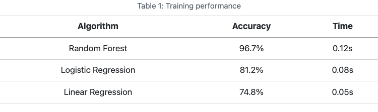
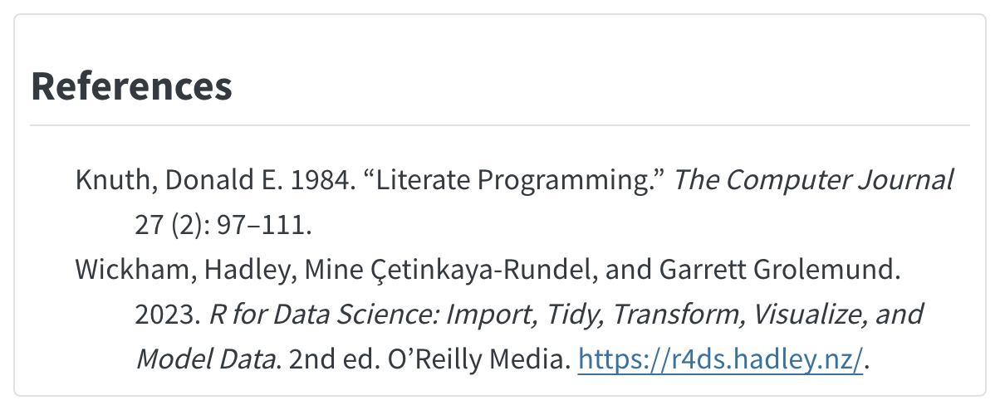

# Markdown {#sec-authoring}


This chapter focuses on what you put in the parts of your document that are interpreted as Quarto markdown---that is, everything that isn't the document header or an executable code cell.
Our goal is to give you an overview of the breadth of Quarto's authoring features, and point you to the [Authoring](https://quarto.org/docs/authoring/markdown-basics.html) section of the Guide in the Quarto documentation for additional depth.

We focus on features and syntax that generally work across output formats.
You'll find details specific to certain formats in the Documents chapters: @sec-html, @sec-typst, and @sec-presentations.

We suggest reading through the chapter in its entirety on your first reading, and then referring back to specific sections as needed when authoring your own documents.

::: callout-note
## Quarto markdown and Pandoc markdown

Quarto reads your markdown with Pandoc's markdown reader, after a small amount of preprocessing.
As a result, Quarto markdown inherits much of Pandoc's syntax, and if you already know Pandoc markdown, a lot of this chapter will look familiar.
However, Quarto markdown is its own variant: Quarto adds syntax and processing of its own, so don't assume every feature in Pandoc's documentation behaves the same way in Quarto.
:::

## Sections {#sec-markdown-sections}

Use markdown headings to structure your document into sections and subsections.
You create a markdown heading by prefixing text with one or more `#` characters, 
followed by a space, and the heading title:

```markdown
## Section

### Subsection

#### Subsubsection

```

You can use six levels of headings, from level-1 (`#`) to level-6 (`######`).
The value of `title` in the document header usually becomes the level-1 heading of the document,
so you'll typically use level-2 headings for sections.

You can attach **attributes** (see @tip-attributes) to headings by adding curly braces `{}` after the heading text.
For example, you might add an identifier to a section heading to enable cross-referencing:

```markdown
## Section Title {#sec-section-title}
```    

Or you might add a class like `.unlisted` to exclude a section from the table of contents:

```markdown
## Section Title {#sec-section-title .unlisted}
```

::: {#tip-attributes .callout-tip}

## What are attributes?

Attributes are a way to add metadata to markdown elements, usually inside curly braces `{}` after the element.
Quarto uses attributes extensively to control the behavior or appearance of many elements.

There are three kinds of attributes:

- Identifiers (IDs), which start with `#` and must be unique
- Classes, which start with `.`
- Key-value pairs, which use `key="value"` syntax

The order of attributes matters: identifiers must come first, followed by classes, and then key-value pairs.

:::

## Paragraphs

Create paragraphs by separating text with blank lines:

```markdown
This is the first paragraph. It can span multiple lines 
in your source document.

This is a second paragraph, separated by a blank line.
```

Quarto ignores line breaks within a paragraph, which means you can wrap your text across multiple lines without affecting the final rendered output.

## Text {#sec-markdown-text}

@tbl-inline-text-elements summarizes the most common things, beyond plain text, that you'll want to put inside a paragraph or heading: formatted text, links, cross-references, citations, math, and footnotes.

These elements are called **inline text elements**, because they are used inline with text, inside what are called **block elements** like paragraphs and headings.
You can also use them inside many of the other block elements discussed in this chapter, such as list items, tables, and callouts.

::: {#tbl-inline-text-elements}

::: {.list-table header-rows=1 widths='1,2,1' aligns="l,l,l" } 


* - Element
  - Output
  - Markdown syntax

* - []{rowspan=7} **Text formatting**
  - _italics_, **bold**, _**bold italics**_
  - ``` markdown
    _italics_, **bold**, _**bold italics**_
    ```

* - superscript^2^ / subscript~2~
  - ``` markdown
    superscript^2^ / subscript~2~
    ```

* - ~~strikethrough~~
  - ``` markdown
    ~~strikethrough~~
    ```

* - `verbatim code`
  - ``` markdown
    `verbatim code`
    ```

* - [smallcaps]{.smallcaps}
  - ``` markdown
    [smallcaps]{.smallcaps}
    ```

* - [underlined]{.underline}
  - ``` markdown
    [underlined]{.underline}
    ```

* - [highlighted]{.mark}
  - ``` markdown
    [highlighted]{.mark}
    ```

* - []{rowspan=3} **Links**
  - <https://quarto.org>
  - ``` markdown
    <https://quarto.org>
    ```

* - [Quarto](https://quarto.org)
  - ``` markdown
    [Quarto](https://quarto.org)
    ```  

* - [Links section](#links)
  - ``` markdown
    [Links section](#links)
    ```

* - **Math** @sec-equations
  - Inline math: $E = mc^{2}$
  - ``` markdown
    Inline math: $E = mc^{2}$
    ```

* - []{rowspan=2} **Cross-references** @sec-crossreferences
  - @fig-elephant
  - ``` markdown
    @fig-elephant
    ```

* - @sec-authoring
  - ``` markdown
    @sec-authoring
    ```

* - []{rowspan=3} **Citations** @sec-citations
  - @knuth1984 shows ...
  - ``` markdown
    @knuth1984 shows ...
    ```

* - ... [@knuth1984]
  - ``` markdown
    ... [@knuth1984]
    ```

* - [@knuth1984; @wickham2023]
  - ``` markdown
    [@knuth1984; @wickham2023]
    ```

* - **Footnotes** @sec-footnotes
  - An inline note.^[Content]
  - ``` markdown
    An inline note.^[Content]
    ```
:::


Common syntax for inline text elements in Quarto markdown
:::

## Lists {#sec-markdown-lists}

You can create an unordered list by starting each line with `-` (or `*` or `+`) followed by a space, 
ensuring there is a blank line before the first item:

```markdown
My list:

- First item
- Second item
- Third item
```

Leaving no blank lines between items will result in a compact list, while leaving a blank line between items will create a loose list with more vertical spacing.

Use numbers followed by a period to create an ordered list:

```markdown
My numbered list:

1. First item
2. Second item
3. Third item
```

The actual numbers you use don't matter---Quarto will renumber the list automatically.

List items can contain other block elements like paragraphs, code blocks, or even other lists.
Indent subsequent elements to line up with the first non-space content after the list marker.
@fig-nested-list shows an example of a nested list, along with its rendered output.

::: {#fig-nested-list}

::: {}
````markdown

````
:::

:::{}
::: {.rendered style="text-align: left;"}

:::
:::

List syntax and its rendered output
:::

You can also create task lists and definition lists.
See the [Lists](https://quarto.org/docs/authoring/markdown-basics.html#lists) section of Markdown Basics in the Quarto documentation for details on these specialized list types.


## Code blocks {#sec-code-blocks}

We use the term **code blocks**, distinct from **code cells**, for code that is displayed but never executed.

There are two equivalent syntaxes for code blocks. 
You can use triple backticks followed by the language name:

````markdown
```sql
SELECT * FROM table;
```
````

Or use triple backticks followed by curly braces with the language name prefaced by a period:

````markdown
```{.sql}
SELECT * FROM table;
```
````

We prefer the second syntax, since it makes it easier to add other code block attributes.
For example, you might add `filename`, which adds a header with the file name above the code block, as shown in @fig-code-block-with-filename.

::: {#fig-code-block-with-filename}
````markdown
```{.sql filename="query.sql"}
SELECT * FROM table;
```
````

```{.sql filename="query.sql"}
SELECT * FROM table;
```

Code block syntax and its rendered output 

:::

:::{.callout-tip}

## Supported code block languages 

The language for code blocks is used only for syntax highlighting.
You can see a list of supported languages by running the following command in your terminal:

```{.bash filename="Terminal"}
quarto pandoc --list-highlight-languages
```

If you specify a language that isn't supported, you'll get no syntax highlighting.

:::


## Tables {#sec-markdown-tables}

The simplest way to add a table to a Quarto document is to create a **markdown pipe table**.
However, cells in a markdown pipe table can't contain block content like multiple paragraphs, code blocks, or lists.
To have cells with complicated cell contents, you can use an alternative syntax called **list tables**.
You can also use **HTML table syntax**, regardless of your target format, to create tables.
You won't usually write HTML syntax by hand, but it is a common output from computational packages that create tables.

Tables are so important in Quarto documents that we dedicate an entire part of this book to them.
For more details, see @sec-figtab.

### Markdown pipe tables {#sec-markdown-pipe-tables}

The simplest syntax for a table in Quarto markdown is known as the **pipe table**, so named because columns are separated by the pipe (`|`) character. 
A pipe table consists of column headers, a separator row of dashes (`-`) and pipes (`|`), and data rows with pipe-separated cells.

@fig-markdown-table gives an example of a pipe table, along with its rendered output.
The line after the table, starting with `:`, is optional and specifies the caption and any attributes for the table (inside curly braces `{}`).
In this example, the table has the identifier `#tbl-perf`, so it is numbered and can be cross-referenced.

::: {#fig-markdown-table}
::: {}
````markdown

````
::: 

::: {}
{fig-alt="Rendered markdown output shows a table titled 'Table 1: Training Performance', with three columns: 'Model', 'Accuracy', and 'Time'. The table has four rows."}
:::

Markdown syntax and rendered output for a markdown pipe table

:::


### List tables

List tables use markdown list syntax to create tables where cells can contain multiple paragraphs, code blocks, or lists.
Wrap a list table in a fenced div with the class `list-table`.
Inside the div, each row is a list item, and each cell is a subitem.

For example, to create the same table content as @fig-markdown-table using a list table, you would include the following in your document:

````markdown

````

To include more complicated content in cells, like code blocks or formulas, include them as you would in normal markdown, but maintain indentation for the list structure, and the required whitespace for the content type:

````markdown

````

### HTML tables {#sec-html-tables}

You can also use HTML to create tables in Quarto documents, regardless of your target format.
You typically won't write HTML tables by hand---instead, you'll generate them with code cells or import them from other tools.

As an example, to generate the same table as @fig-markdown-table with HTML, you could include the following in your document:

````markdown

````

### From a code cell {#sec-computational-table}

When the output from an executable code cell is a markdown or HTML table, 
it will be included in your Quarto document.

To add an identifier and caption to the table, use the code cell options `label` and `tbl-cap` respectively:

````markdown
```{LANGUAGE}
#| label: tbl-example
#| tbl-cap: "Caption"

# Code that generates a markdown or HTML table
```
````

## Images and figures {#sec-markdown-figures}

You can include images in your document either from an image file or from the output of an executable code cell.

Figures are so important in Quarto documents that we dedicate an entire part of this book to them.
For more details, see @sec-figtab.

::: {.callout-tip}

## Image or figure?

We use the term **figure** to refer to any image, numbered or not, included in a document.
You may be more used to using the term figure to refer to an image with a numbered caption---we'll call this a **cross-referenceable figure**. 

:::

### From a file

To include an image file in markdown, use the following syntax:

```markdown

```

The path to the image is relative to the current document.

::: {.callout-tip}

## Project-relative paths

If you preface the path with `/`, it is interpreted as a path relative to the project root.
You'll learn more about project structure in @sec-projects.

:::

You can add a caption inside the square brackets, an identifier inside curly braces after the image path, and alternative text for accessibility in a `fig-alt` attribute:

```{.markdown .code-overflow-wrap}
{#fig-quarto fig-alt="Alternative text"}
```

If your identifier starts with `fig-`, the image becomes a numbered, cross-referenceable figure that you can reference with the `@` syntax (see @sec-crossreferences).

### From a code cell {#sec-computational-figure}

If the output from an executable code cell is an image, it will be automatically included in your document.
To add an identifier, caption, or alternative text, use the code cell options `label`, `fig-cap`, and `fig-alt` respectively:

````markdown
```{LANGUAGE}
#| label: fig-quarto
#| fig-cap: "Caption"
#| fig-alt: "Alternative text"

# Code that generates a plot
```
````

## Mathematical equations {#sec-equations}

You can include formulas and equations in your document using **TeX math** syntax.
TeX math is the notation originally developed for the TeX typesetting system.
It's now the de facto standard across technical writing tools.
For example, Wikipedia, scientific journals, Jupyter notebooks, and nearly every markdown processor understand it.
If you're new to TeX math, the [LaTeX Wikibook's Mathematics chapter](https://en.wikibooks.org/wiki/LaTeX/Mathematics) is a gentle tutorial.
Not all TeX math constructs are supported, but most of the common ones are.
The best way to know whether a particular construct is supported is to render and see.

There are two ways to include math: **inline math**, wrapped in single `$`, appears within a line of text, and **display math**, wrapped in `$$`, appears centered on its own line.
@tbl-math-examples shows examples of both.

To number and cross-reference a display equation, add an identifier starting with `eq-` (see @sec-crossreferences for more details).

::: {#tbl-math-examples}

::: {.list-table header-rows=1 widths='1,2,1' aligns="l,l,l" }
* - Element
  - Output
  - Markdown syntax

* - Inline math
  - ... $E = mc^{2}$ ...
  - ``` markdown
    ... $E = mc^{2}$ ...
    ```
* - Display math
  - The formula is:
    $$
    E = mc^{2}
    $$
  - ``` markdown
    The formula is:
    $$
    E = mc^{2}
    $$
    ```
:::

Math syntax examples and their rendered output
:::


### Theorems and proofs {#sec-theorems-proofs}

To get special styling for theorems, proofs, and related blocks, wrap the block in a fenced div with an identifier that uses the appropriate prefix.
The block is numbered automatically and can be cross-referenced with `@`:

````{.markdown .code-overflow-wrap}
::: {#thm-pyth}
## Pythagorean Theorem
For a right triangle with legs $a$ and $b$ and hypotenuse $c$:
$$a^2 + b^2 = c^2$$
:::

The Pythagorean theorem (@thm-pyth) is fundamental to Euclidean geometry.
````

@tbl-theorem-prefixes lists the available prefixes and the block they produce.

::: {#tbl-theorem-prefixes}

::: {.list-table header-rows=1 widths='1,2' aligns="l,l"}
* - Prefix
  - Block

* - `thm-`
  - Theorem
* - `lem-`
  - Lemma
* - `cor-`
  - Corollary
* - `prp-`
  - Proposition
* - `cnj-`
  - Conjecture
* - `alg-`
  - Algorithm
* - `def-`
  - Definition
* - `exm-`
  - Example
* - `exr-`
  - Exercise
* - `prf-`
  - Proof (`format: typst` and `format: html` only)
* - `rem-`
  - Remark
* - `sol-`
  - Solution
:::

Identifier prefixes for theorem-like and proof-like blocks
:::

The `prf-` prefix isn't supported under `format: pdf` (LaTeX).
For a cross-format proof, use the class form instead:

````markdown
::: {.proof}
Apply Markov's inequality to $(X - \mu)^2$.
:::
````

The result is an unnumbered, non-cross-referenceable proof block.
Similarly, `.remark` and `.solution` classes are available for unnumbered forms of `rem-` and `sol-` blocks.

## Cross-references {#sec-crossreferences}

Cross-references are automatically generated links to elements within your document, like figures, tables, sections, and equations. 
When you render your document, Quarto automatically numbers these elements and creates the links.

To create a cross-reference you need to do two things:

1. **Add an identifier** that starts with a specific prefix to the element you want to reference.

2. **Reference the element** elsewhere in your document using `@` followed by the identifier.

@tbl-crossref-prefixes gives examples of common elements, their prefixes, and an example of adding the identifier as an attribute.
For computational outputs, like figures and tables generated from code cells, you add the identifier using the `label` code cell option.
You can see an example for a table in @sec-computational-table, a figure in @sec-computational-figure, and many more details in @sec-figtab-crossrefs.

::: {#tbl-crossref-prefixes}
::: {.list-table header-rows=1 widths='1,2,2' aligns="l,l,l"}

* - Element type
  - Prefix
  - Markdown

* - Figure
  - `fig-`
  - ```` markdown
    {#fig-elephant}
    ````

* - Table
  - `tbl-`
  - ```` markdown
    | Header 1 | Header 2 |
    |----------|----------|
    | Data 1   | Data 2   |

    : Caption {#tbl-results}
    ````

* - Section
  - `sec-`
  - ```` markdown
    ## Introduction {#sec-intro}
    ````

* - Equation
  - `eq-`
  - ```` markdown
    $$
    a^2 + b^2 = c^2 
    $$ {#eq-py}
    ````

* - Code listing
  - `lst-`
  - ```` markdown
    ```{#lst-example .python}
    ```
    ````

* - Theorem
  - `thm-` (see @tbl-theorem-prefixes for other theorem-like blocks)
  - ```` markdown
    ::: {#thm-main}
    ## Theorem name

    Theorem content
    :::
    ````

* - Callout
  - `nte-`, `tip-`, `wrn-`, `imp-`, `cau-`
  - ``` markdown
    :::{#nte-df .callout-note}
    ## Heading

    Content
    :::
    ```


:::

Common cross-reference types
:::

Once labeled, you can cross-reference an element using the `@` syntax.
@tbl-crossref-examples gives examples of this syntax.

::: {#tbl-crossref-examples}

::: {.list-table header-rows=1 aligns="l,l,l"}

* - Description
  - Output
  - Markdown syntax

* - Basic reference
  - @fig-elephant
  - `@fig-elephant`

* - Custom prefix
  - [Fig @fig-elephant]
  - `[Fig @fig-elephant]`

* - Number only
  - [-@fig-elephant]
  - `[-@fig-elephant]`

* - Multiple references
  - [@fig-elephant; @fig-panther]
  - `[@fig-elephant; @fig-panther]`
:::

Examples of cross-reference syntax and their rendered output
:::

For more details on cross-referencing specific element types, see the [Cross References](https://quarto.org/docs/authoring/cross-references.html) page in the Quarto documentation.

::: {.rendered layout-ncol="2"}
{#fig-elephant width="25%"}

{#fig-panther width="25%"}

Some placeholder images for cross-referencing examples
:::


## Citations {#sec-citations}

You can automatically generate citations and a bibliography in a number of styles.
To do so, you need:

1. A bibliographic data source, for example a BibLaTeX (`.bib`) or BibTeX (`.bibtex`) file.

2. A Quarto document formatted with citations.

Add a bibliography file to your document using the `bibliography` option in the document header.
For example:

``` yaml
---
title: "My Document"
bibliography: references.bib
---
```

See @tip-bib for an example `references.bib` file.
Then you can cite references from the bibliography file using their identifiers and the citation syntax described in @tbl-citation-syntax.

::: {#tbl-citation-syntax}
:::{.list-table header-cols=1}

- - Markdown syntax
  - Output

- - ``` markdown
    @knuth1984 shows ...
    ```
  - @knuth1984 shows ...

- - ``` markdown
    ... [@knuth1984]
    ```
  - ... [@knuth1984]

- - ``` markdown
    As Knuth [-@knuth1984] shows ...
    ```
  - As Knuth [-@knuth1984] shows ...

- - ``` markdown
    [@knuth1984; @wickham2023]
    ```
  - [@knuth1984; @wickham2023]

:::

Common citation syntax
:::

When you render your document, Quarto will automatically generate a bibliography at the end of your document with all cited references (@fig-references-section).

::: {#fig-references-section}

::: {.content-visible when-format="html"}
::: {.rendered style="text-align: left;"}
## References {.unnumbered .unlisted}

::: {.csl-bib-body .hanging-indent}
::: {.csl-entry}
Knuth, Donald E. 1984. "Literate Programming." *The Computer Journal* 27 (2): 97--111.
:::

::: {.csl-entry}
Wickham, Hadley, Mine Çetinkaya-Rundel, and Garrett Grolemund. 2023. *R for Data Science: Import, Tidy, Transform, Visualize, and Model Data*. 2nd ed. O'Reilly Media. <https://r4ds.hadley.nz/>.
:::
:::
:::
:::

::: {.content-visible unless-format="html"}
{fig-alt="A section with the heading References, listing two references with hanging indents: Knuth (1984), Literate Programming, and Wickham, Çetinkaya-Rundel, and Grolemund (2023), R for Data Science."}
:::

Automatically generated references section
::: 

The appearance of the citations both inline and in the bibliography depends on the citation style as defined in a CSL file.
By default, Quarto uses the [Chicago Manual of Style](https://chicagomanualofstyle.org/) author-date format, but you can provide a custom CSL file using the `csl` option in your document header, for example:

``` yaml
---
title: "My Document"
bibliography: references.bib
csl: nature.csl
---
```

::: {#tip-bib .callout-tip}

## What's in `references.bib`?

A `.bib` file is a plain text file that contains bibliographic entries in a specific format:

```{.bib filename="references.bib"}

```

You can manage this file by hand, but usually you'll use a tool to manage it for you.
You could export a `.bib` file from your reference manager of choice.
Or, in the visual editor, you can use the "Add Citation" button in the toolbar.
:::

::: {.callout-note}

When you use `format: typst`, Typst handles citation processing by default.
See @sec-typst for more details.

::: 

## Footnotes {#sec-footnotes}

The simplest syntax for footnotes uses a caret (`^`) followed by the footnote contents inside square brackets:

```{.markdown .code-overflow-wrap}
Here is some text that needs a footnote.^[Here is the footnote.]
```

However, for longer footnotes, or footnotes with multiple paragraphs, 
specify a footnote identifier and define the footnote contents elsewhere in the document,
as shown in @fig-long-footnote.

::: {#fig-long-footnote}

````{.markdown .code-overflow-wrap}

````

::: {.rendered style="text-align: left;"}

:::

Long footnote syntax and rendered output
:::

## Fenced divs {#sec-fenced-divs}

**Fenced divs** are a component that Quarto uses extensively to create block-level regions of content with specific behaviors or styles.
For example:

- callout blocks (@sec-callouts) are specified as fenced divs with a special class attribute,
- a two-column panel layout (@sec-layout) is specified using a fenced div with a key-value attribute, and
- you can make an element cross-referenceable with an identifier attribute that starts with a special prefix.

::: callout-tip

## What's a div?

The term **div** originates from the `<div>` tag in HTML, where it is used to define a division or region in a document.
The term **fenced div** comes from Pandoc markdown, and describes the specific markdown syntax used to create a div with a fence of colons (`:::`). 

Fenced divs provide a way to create `<div>` elements when rendering to HTML. 
But, more importantly, fenced divs are easily intercepted by Quarto.
The result is that many Quarto features use the fenced div syntax to define a region of content that needs special handling. 
Quarto recognizes these divs, processes them, and inserts suitable markup depending on the target format. 

:::

A fenced div begins with at least three consecutive colons followed by curly braces, possibly empty, that contain attributes.
The div ends with another line of at least three consecutive colons.
Separate the div from the blocks before and after it with blank lines.
For example, here's a fenced div with no attributes:

``` markdown
::: {}
This content is inside a div with no attributes
:::
```

The attributes may include an identifier (starting with `#`), 
one or more classes (starting with `.`), and key-value pairs (`key='value'`):

``` {.markdown .code-overflow-wrap}
::: {#id .class1 .class2 key='value'}
This content is inside a div with an identifier, two classes, and a key-value attribute
:::
```

You can also nest fenced divs inside one another:

``` markdown
::::: {#id .class1 .class2 key='value'}

::: {}
Content inside the nested div
:::

More content inside the top-level div
:::::
```

The number of colons used to open and close a fenced div doesn't need to match,
but it can be useful to match them for readability.

::: {.callout-tip}

## A single class shorthand

When the only attribute of a fenced div is a single class, you can use a shorthand syntax that omits the curly braces and the `.` on the class name:

````markdown
::: class-name
Contents of the div.
:::
````

:::

## Callouts {#sec-callouts}

Callouts are special fenced divs with one of the callout classes: `.callout-note`, `.callout-tip`, `.callout-warning`, `.callout-caution`, or `.callout-important`.
They are typeset across formats to set their contents apart from the main document text (@fig-callout-note).

::: {#fig-callout-note}
``` markdown
:::{.callout-note}
## Types of callout

There are five types of callouts:
`note`, `tip`, `warning`, `caution`, and `important`.
:::
```

:::{style="text-align: left;"}
:::{.callout-note}
## Types of callout

There are five types of callouts:
`note`, `tip`, `warning`, `caution`, and `important`.
:::
:::

Syntax and rendered output for a note callout
:::

You can add key-value attributes to callouts to customize their behavior:

::: {.list-table header-rows=1 widths='1,3' aligns="l,l"}

* - Key
  - Values

* - `appearance` 
  - - `"default"`: Standard callout with colored background and border
    - `"simple"`: Lighter styling with minimal background
    - `"minimal"`: Most subtle styling with just a left border

* - `collapse` 
  - - `true`: Callout starts collapsed and can be expanded by clicking
    - `false`: Callout starts expanded and can be collapsed by clicking

* - `icon`
  - - `true`: Shows the icon for the callout type (default)
    - `false`: Hides the icon

:::

See more examples on the [Callout Blocks](https://quarto.org/docs/authoring/callouts.html) page in the Quarto documentation.

## Layout {#sec-layout}

Fenced divs (@sec-fenced-divs) are also used to lay out content on the page.
There are two common ways to control layout:

- **Panel layouts** arrange content in rows and columns using `layout-*` attributes, useful when you want elements to be side by side or arranged in a grid.

- **Column classes** arrange content across different widths of the page, useful when you need to give content more horizontal space, or put elements in the margin.

### Panel layouts

Use a fenced div with the `layout-ncol` key-value attribute to arrange content in multiple columns.
It's best to be explicit about what each item is by nesting each one in its own fenced div.

For example, to place two items side by side in two columns, set `layout-ncol="2"` and nest each item in its own fenced div, as shown in @fig-two-column-layout.

::: {#fig-two-column-layout}

````markdown
::::: {layout-ncol="2"}
::: {}
Content for the first column.
:::

::: {}
Content for the second column.
:::
:::::
````

:::{.rendered style="text-align: left;"}
::::: {layout-ncol="2"}
::: {}
Content for the first column.
:::

::: {}
Content for the second column.
:::
:::::
::: 

Two-column layout syntax and rendered output
:::

The content inside each item can be any block content, including paragraphs, lists, code cells, images, or tables.
Additional items fill new rows, and Quarto allocates vertical space as needed.
In HTML formats, the layout is responsive so that on smaller screens the items will stack vertically.

Use the `layout-nrow` attribute if you'd prefer to specify the grid by the number of rows, or, for more complicated layouts, use the `layout` attribute.
You can see more examples using figures and tables as content in @sec-figtab-layout.

### Column classes

For `format: html` and `format: typst`, the page is divided into a body content area and a right margin.
By default, your content will be placed in the body area.
You can override this by putting content in a fenced div and adding special `column` classes.

For example, to place content in the right margin, use the `.column-margin` class:

:::{#fig-column-margin}
````markdown
::: {.column-margin}
This content will appear in the right margin.
:::
````

::: {.column-margin .rendered}
This content will appear in the right margin.
:::

Column margin syntax and rendered output
:::

Use the `.column-page-right` class to expand content into the margin to give it more horizontal space:

:::{#fig-column-page-right}
````markdown
::: {.column-page-right}
This content will expand into the right margin.
:::
````

::: {.column-page-right .rendered}
This content will expand into the right margin.
:::

Column page right syntax and rendered output
:::

Other classes give content more horizontal space and, for `format: html`, let it extend to the left or across the full screen width.
See the [Available Columns](https://quarto.org/docs/authoring/article-layout.html#available-columns) section of Article Layout in the Quarto documentation for the full list of classes.

You can also see more examples with figures and tables, including computational outputs, in @sec-figtab-layout.

## Raw blocks {#sec-raw-blocks}

Occasionally, you may need to add format-specific syntax directly to your document.
Raw blocks let you do this: Quarto doesn't process their contents, and omits them from formats where they aren't relevant.

A raw block begins with triple backticks followed by curly braces containing an equals sign (`=`) and the format name.
For example, you might use a raw block to add an iframe to an HTML document:

````{.markdown .code-overflow-wrap}
```{=html}
<iframe src="https://example.com" width="600" height="400"></iframe>
```
````

There are more examples of raw blocks in @sec-html and @sec-typst.

## Shortcodes {#sec-shortcodes}

Shortcodes are special commands that are replaced with specific content when the document is rendered.
The shortcode syntax uses double curly braces and angle brackets: `{}`.
The shortcode name can be followed by additional arguments or key-value pairs.

As an example, the `meta` shortcode inserts values from the document metadata into your document.
@fig-meta-shortcode shows how you might use it to keep text that changes often, like a client name, in an option in your document header.

::: {#fig-meta-shortcode}

```{.markdown shortcodes="false"}
---
client: "ACME Corp"
---

**Client:** 
```

:::{.rendered style="text-align: left;"}
**Client:** 
:::  

Shortcode syntax and rendered output for the `meta` shortcode
:::

You can find a list of built-in shortcodes on the [Shortcodes](https://quarto.org/docs/authoring/shortcodes.html) page in the Quarto documentation.
You can also add shortcodes via extensions (@sec-extensions).

## Includes {#sec-includes}

The `include` shortcode lets you insert the contents of another file directly into your document. 
This is useful when you want to reuse content across multiple documents or break a large document into smaller, more manageable files.

The basic syntax is:

```{.markdown}
{}
```

Here, `_content.qmd` is the path to the file you want to include,
relative to the current document.
Prefix files that contain content to include with an underscore (`_`), so that Quarto doesn't render them on their own.

::: {.callout-tip}

## Project-relative paths

If you preface the path with `/`, it is interpreted as a path relative to the project root.
You'll learn more about project structure in @sec-projects.

:::

## Other features

- **Diagrams**: create diagrams directly in your markdown using Mermaid or Graphviz syntax. See the [Diagrams](https://quarto.org/docs/authoring/diagrams.html) page in the Quarto documentation for details.

## Wrapping up

This chapter has focused on how to write a rich document using Quarto markdown.
You've learned to use markdown headings to structure your document into sections, create paragraphs and lists, and format text with emphasis, links, and other inline elements. 
You've seen how to add the most important components of technical and scientific writing: code, tables, images, and equations.

You've also learned how to use key Quarto features like cross-references, citations, footnotes, and callouts.
Fenced divs let you create special regions like callouts or multi-column layouts, while shortcodes and includes help you reuse content efficiently. 

You'll likely want to return to specific sections of this chapter as a reference when you write your own documents.
For the complete reference, see the [Authoring](https://quarto.org/docs/authoring/markdown-basics.html) section of the Guide in the Quarto documentation.