# HTML {#sec-html}

## Overview

This chapter covers HTML documents, the default format in Quarto.
There are good reasons HTML is the default:

* It renders fast: a quick edit-preview cycle means you can iterate on your document without friction.

* It displays almost anywhere: all that a reader needs is a web browser, available on desktops, Chromebooks, tablets and mobile devices. 

* It's one of the most accessible formats: HTML has a long history of support from assistive technologies and guidelines, like the WCAG, exist for authoring accessible HTML.

Here we focus on `format: html` for single standalone documents. 
However, HTML documents are also the building blocks of websites, where each HTML document becomes a webpage. 
Read this chapter to learn about what goes on a web page, and head to @sec-websites to learn how to combine them into a website.

For standalone documents where you want content to appear exactly the same for every viewer, or you need to conform to a  "paged" layout, PDF may be a better option.
PDF viewers are also widely available, but have a shorter history of supporting assistive technology. 
You can learn more about creating PDFs in @sec-typst.

In the next section, you'll create your first HTML document, learn why you should view it through `quarto preview`, and see what makes HTML output responsive and interactive.
Then you'll learn about the parts of the page that frame your content: the title block at the top, the navigation that helps readers move around, and the appendix at the end.
Next, you'll cover the types of content you'll most likely need in your first few documents: code blocks, tabsets, math, citations, computational outputs, full width and margin content, and raw HTML.

In @sec-html-accessibility, you'll learn how to check your document for accessibility problems, and the practices that help you avoid them.
In @sec-html-customizing-appearance, you'll learn how to change the look of your document with themes, brand colors and fonts, and CSS, and in @sec-html-advanced-customization, how to go further with column widths, `include-` options, and template partials.

Finally, you'll learn how to share your HTML document with others (@sec-html-sharing).

## Your first HTML document {#sec-html-first-document}

Since HTML is the default format in Quarto, you've already worked with a few HTML documents. 
But, to be concrete, here's a short but complete example, with some common content types:

````{.markdown filename="train-punctuality.qmd" .code-overflow-wrap}

````

Since `html` is the default format, you could omit `format: html`, and still get HTML output.

When rendered the result is `train-punctuality.html`, shown in @fig-html-first-document-train-punctuality.

{#fig-html-first-document-train-punctuality .border fig-alt="A rendered HTML page showing a Route Punctuality Report with a table of on-time rates by route and a recommendations section."}


## Preview, don't open {#sec-html-preview}

When you call `quarto preview` on an document targeting `format: html`, there are two steps Quarto takes. 
First, it renders the document, then it serves it with a local webserver. The preview you see comes from pointing your browser at this webserver: you'll see the URL starting with something like `http://localhost`, or `http://127.0.0.1`

This is subtly different from rendering your document and opening the resulting `.html` file in your browser.
If you do that, you'll see the URL starts with `file://`.

When browsers open a file from a `file://` address they often restrict what it can do.
For example, Chrome refuses to load JavaScript modules from a `file://` address.
Since some Quarto features are implemented as JavaScript modules, when you view a `file://` page in these browsers you may lose functionality.

Some features you might lose include:

* a highlight of the current section in the table of contents,
* the table of contents hiding when it overlaps with margin content, and
* tabsets in the same `group` switching together.

In general, you'll always want to examine your rendered document from the preview, not open the resulting `.html`.

When you share your document, publishing it and sharing the URL is the preferred method. 
However, if you want to send someone the rendered `.html`, and have them open it directly, you can avoid losing the above features by embedding the JavaScript directly in the document as described in  @sec-sharing-other-ways.

## HTML is responsive and interactive {#sec-html-responsive}

It's worth pausing to highlight some of the properties unique to HTML^[We are talking about `format: html` in this chapter, but these HTML properties apply to other formats that produce `.html` files like `format: revealjs` and `format: dashboard`] output.
We call HTML output **responsive** because it responds to the properties of the browser window in which it is viewed:

* On small screens, the full width of the screen is used for your content. On larger screens, your content only takes up the middle column, and other things, like a table of contents, lie in the margin.

* Images, by default, resize to fit the width of the main content.

* Panel layouts (@sec-layout-panel) that lay out components out in a row, collapse into columns on small screens.

You can see this in @fig-html-responsive, which shows the document from @sec-html-first-document, with a table of contents added, at two screen widths.
On a wide screen the table of contents sits in the right margin, but on a narrow screen it's hidden and the body text uses the full width.

::: {#fig-html-responsive layout="[70,30]" layout-valign="top"}
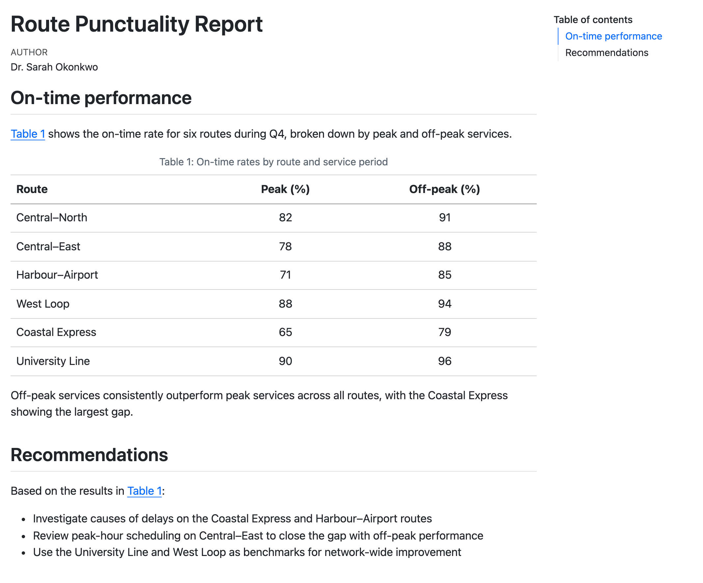{#fig-html-responsive-wide .border fig-alt="The Route Punctuality Report with the body text on the left and a table of contents, listing On-time performance and Recommendations, in the right margin."}

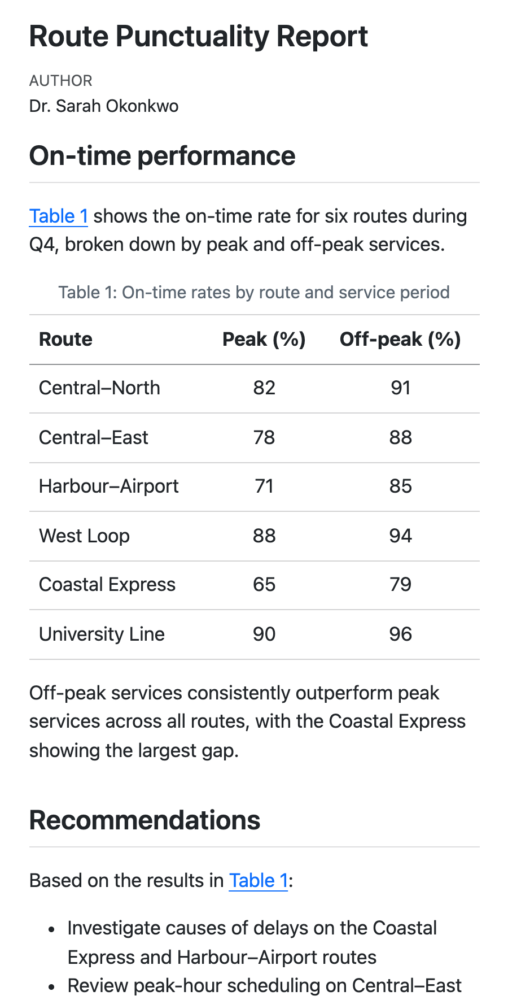{#fig-html-responsive-narrow .border fig-alt="The same Route Punctuality Report in a narrow window. There is no table of contents, the table fills the width of the window, and long lines wrap."}

The Route Punctuality Report from @sec-html-first-document viewed at two screen widths
:::

We call HTML **interactive** because readers' actions can change the visible content:

* Readers can hover over cross-references, footnotes and citations to see the linked content (@fig-html-crossrefs-hover).

* Readers can expand collapsed callouts or code blocks to reveal content.

* Readers can switch between tabs in a tabset (@sec-html-tabsets).

These HTML features do benefit many readers but you should keep in mind their limitations:

* Responsive and interactive features don't transfer to static formats like `docx`, `pdf` and `typst`. 

* Responsive and interactive features may pose accessibility challenges.

Throughout this chapter, we'll point out features that respond to screen size or to reader actions.
For most of them, we describe what the feature does and when it helps your readers, then point you to the Quarto documentation for the full set of options.

## Title block {#sec-html-title-block}

The metadata from your document header is used to build a **title block** at the top of your document.
The document in @sec-html-first-document had a title block built from just `title` and `author` (@fig-html-first-document-train-punctuality-title-block).

{#fig-html-first-document-train-punctuality-title-block .border fig-alt="The heading Route Punctuality Report, with a small grey label reading Author above the name Dr. Sarah Okonkwo."}

### Title block fields

The title block can display more fields if you set them.
@fig-html-title-block-default shows a title block that uses most of fields you can display.

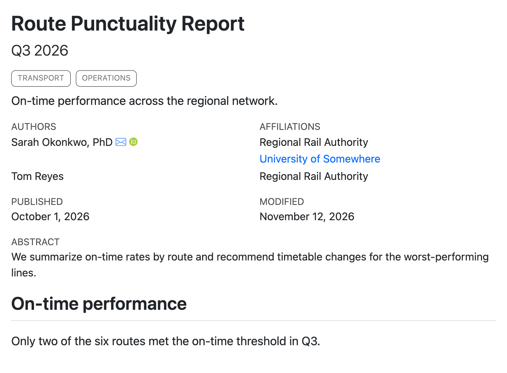{#fig-html-title-block-default .border fig-alt="A title block with the heading Route Punctuality Report, the subtitle Q3 2026, two tags reading Transport and Operations, and a one-line description. Below, an Authors column lists Sarah Okonkwo, PhD, with email and ORCID icons, and Tom Reyes. An Affiliations column lists Regional Rail Authority and University of Somewhere, as a link, next to Sarah, and Regional Rail Authority next to Tom. Below are Published and Modified dates, then an Abstract."}

Here's the document header that produced it:

````{.yaml filename="report.qmd"}

````

Each author is an item in a list, with a `name` and an optional `affiliation`.
An affiliation can be a name only, or have a `name` and a `url`.
Because the authors have affiliations, Quarto lists authors and affiliations in two columns.

@tbl-html-title-block-fields lists all the fields that Quarto displays in the title block, with examples.

::: {#tbl-html-title-block-fields}

::: {.list-table header-rows=1 widths='1,2,2' aligns=l,l,l}

* - Option
  - Description
  - Example

* - `title`
  - The main heading
  - 

    ```yaml
    title: Route Punctuality Report
    ```

* - `subtitle`
  - Larger text under the title
  - 

    ```yaml
    subtitle: Q3 2026
    ```

* - `description`
  - A short summary under the title
  - 

    ```yaml
    description: On-time performance by route.
    ```

* - `categories`
  - Tags under the title
  - 

    ```yaml
    categories: [transport, operations]
    ```

* - `author`
  - A single author or array of authors, with optional links,email and ORCID.
  - 

    ```yaml
    author: Sarah Okonkwo
    ```

    ```yaml
    author: 
      - Sarah Okonkwo
      - Tom Reyes
    ```

    ```yaml
    author:
      name: Sarah Okonkwo
      affiliation: Regional Rail Authority
    ```

* - `affiliation`
  - Affiliations of each author. Set it inside an author, or list them once in a top-level `affiliations` and refer to them by `id`.
  - 

    ```yaml
    author:
      - name: Tom Reyes
        affiliation: Regional Rail Authority
    ```

    ```yaml
    author:
      - name: Sarah Okonkwo
        affiliation:
          - Regional Rail Authority
          - University of Somewhere
    ```

    ```yaml
    author:
      - name: Sarah Okonkwo
        affiliation:
          - ref: rra
      - name: Tom Reyes
        affiliation:
          - ref: rra
    affiliations:
      - id: rra
        name: Regional Rail Authority
    ```

* - `date`
  - Published date. A date, or one of `today`, `now`, or `last-modified`. Quarto will format the date based on the document's language.
  - 

    ```yaml
    date: 2026-10-01
    ```

    ```yaml
    date: today
    ```

* - `date-modified`
  - Modified date. Takes the same values as `date`.
  - 

    ```yaml
    date-modified: last-modified
    ```

* - `doi`
  - DOI, linked to `doi.org`
  - 

    ```yaml
    doi: 10.5555/12345678
    ```

* - `abstract`
  - Abstract. A block of text below the other fields
  - 

    ```yaml
    abstract: |
      We summarize on-time rates
      by route.
    ```

* - `keywords`
  - Keywords, a comma-separated list
  - 

    ```yaml
    keywords: [punctuality, rail]
    ```

:::

Fields displayed in the HTML title block.
:::

Other author and affiliation keys, like `corresponding` or `department`, aren't displayed in the HTML title block, but other formats can use them.
The [Front Matter](https://quarto.org/docs/authoring/front-matter.html) documentation lists all the available keys along with additional examples.

### Banner title block

For a more prominent title block, add the document option `title-block-banner`:

````{.yaml filename="report.qmd"}

````

The title, subtitle, description, and categories move into a colored full-width banner based on your theme, and the other fields stay below it (@fig-html-title-block-banner).

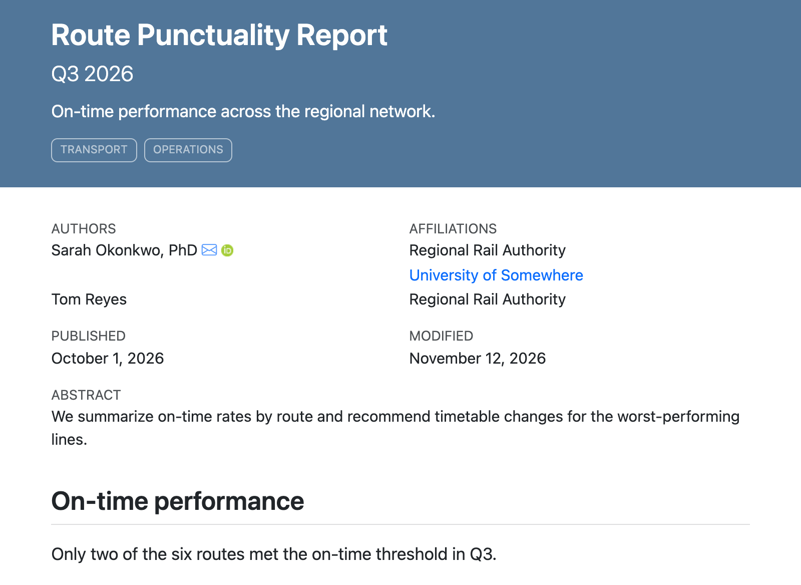{#fig-html-title-block-banner .border fig-alt="The same title block, but the title, subtitle, description, and tags are in white text on a full-width blue banner. The authors, affiliations, dates, and abstract are below the banner on a white background."}

You can also set a custom color, use an image, or customize the labels used for each field.
Find the details on [Title Block](https://quarto.org/docs/authoring/title-blocks.html) in the Quarto documentation.

If you want to add fields to the title block, or change its layout, you'll need to provide your own title block partial.
You'll see an example in @sec-html-advanced-customization.

## Navigation

### Table of contents {#sec-html-toc}

A table of contents gives readers an outline of your document, along with quick navigation to sections.

You can can one with `toc: true` in your document header:

```{.markdown filename="document.qmd"}
---
title: "Route Punctuality Report"
author: "Dr. Sarah Okonkwo"
format: html
toc: true
---
```

By default, the table of contents appears in the right margin (@fig-html-navigation-toc), and disappears on small screens (@fig-html-responsive).

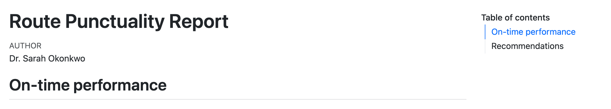{#fig-html-navigation-toc .border fig-alt="The title, author and first heading of the Route Punctuality Report, with a table of contents in the right margin listing the two sections, On-time performance and Recommendations. On-time performance is highlighted as the current section."}

Exclude a heading by adding the `.unnumbered` and `.unlisted` classes:

```{.markdown filename="document.qmd"}
## Heading {.unlisted .unnumbered}
```

For technical writing you might also want sections to be numbered, add `number-sections: true`:

```{.markdown filename="document.qmd"}
---
title: "Route Punctuality Report"
author: "Dr. Sarah Okonkwo"
format: html
toc: true
number-sections: true
---
```

When sections are numbered, cross-references also get a section number prefix.
For example, the first figure in the first section becomes Figure 1.1.

Additional document options control the maximum heading level included (`toc-depth`), the level of headings to show initially (`toc-expand`), and where the table of contents is displayed (`toc-location`).

By default, when a reader clicks an entry in the table of contents, or any other link to a place in the page, the browser jumps straight there.
Set `smooth-scroll: true` to make the browser scroll to the new spot instead.
Read more in the [Smooth Scrolling](https://quarto.org/docs/output-formats/html-basics.html#smooth-scrolling) section of the Quarto documentation.

### Links {#sec-html-links}

You can create links using the usual markdown link syntax:

```{.markdown}
An external link to [Quarto](http://quarto.org).
```

The text displayed is inside the square brackets and the link target in the parentheses.

To link to sections in your document use the identifier for the section.
Quarto adds identifiers to all sections automatically by kebab-casing, and deduplicating, the section headings.
For instance a section defined by `## Data methods`, can be linked to using `#data-methods` for the target.

Alternatively, set your own identifier on a section inside curly braces:

```{.markdown filename="report.qmd"}
## Data methods {#data}
```

Start the identifier with `sec-` if you also want to cross-reference the section.

By default, each heading also gets an anchor link: a []{.bi .bi-link-45deg role="img" aria-label="link"} icon after the heading text that is visible when a reader hovers over the heading.
Anchor links give readers a quick way to share a direct link to a section.
A reader clicks the icon, then copies the URL from their browser's address bar.
To turn off anchor links, set `anchor-sections: false` (see [Anchor Sections](https://quarto.org/docs/output-formats/html-basics.html#anchor-sections) in the Quarto documentation).

By default, links to other sites look the same as links within your document, and they open in the same browser tab.
To mark external links with a []{.bi .bi-box-arrow-up-right role="img" aria-label="box with an arrow pointing out"} icon, set `link-external-icon: true` (see [External Links](https://quarto.org/docs/output-formats/html-basics.html#external-links) in the Quarto documentation).

### Cross references

In HTML cross-references (@sec-crossreferences) serve as a richer type of link to elements in your document like figures and tables.
Readers can hover over the cross-reference to get a preview of the element,
and click the cross-reference to navigate to the element.

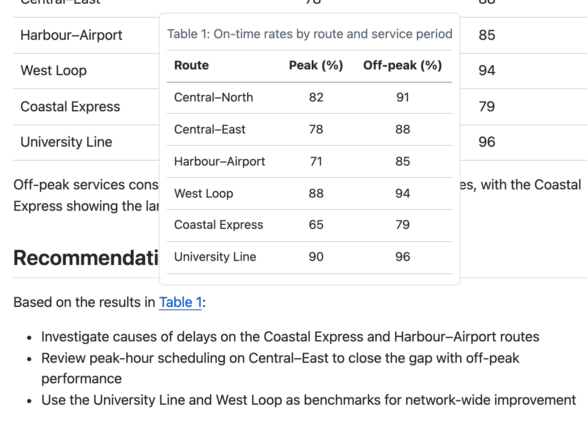{#fig-html-crossrefs-hover .border fig-alt="The Recommendations section of the Route Punctuality Report. The mouse is over the link Table 1, and a pop-up above the link shows a copy of the table with its caption."}

::: todo
[CVW] The typst chapter doesn't have this section. Do we need it here? Do we need it there? We use it in the "first document", so we need to introduce the syntax earlier in the book.
:::

### Reference popups {#sec-html-reference-popups}

Footnotes and citations get the same hover preview as cross-references (@fig-html-crossrefs-hover) by default.

To turn off the popups, set `footnotes-hover: false`, `citations-hover: false`, or `crossrefs-hover: false`.
Read more in the [Reference Popups](https://quarto.org/docs/output-formats/html-basics.html#reference-popups) section of the Quarto documentation.

### Other navigational elements

There are a few other elements you can add via document options for navigation.
These are shown below the table of contents, usually in the right margin but configurable with `toc-location`.
These are shown under the following headings:

* **Other formats***: added automatically when more than one `format` is specified, or with `other-formats`
* **Other links**: add with `other-links`
* **Code links**: add with `code-links` 

@fig-html-navigation-other-links shows a document with all three.

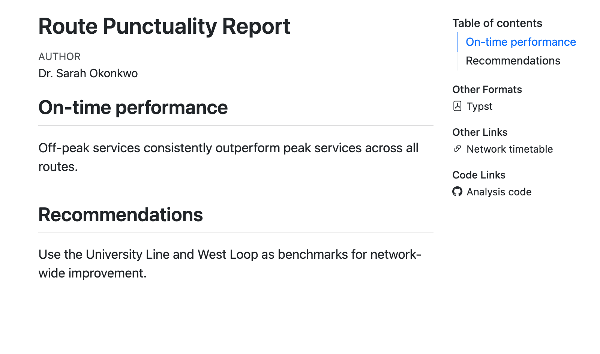{#fig-html-navigation-other-links .border fig-alt="The Route Punctuality Report with its body text on the left. The right margin has four headed lists: Table of contents with two sections; Other Formats with a link to Typst; Other Links with a link to Network timetable; and Code Links with a GitHub icon and a link to Analysis code."}

You can read more about these in the documentation for [Code links and other links](https://quarto.org/docs/output-formats/html-basics.html#code-links-and-other-links) and [Including Other Formats](https://quarto.org/docs/output-formats/html-multi-format.html#specifying-formats-to-link).

## Appendix {#sec-html-appendix}

At the end of an HTML document, Quarto collects material that supports the main content into an appendix.
If you have citations or footnotes, they will go there automatically. 

You can add your own sections to the appendix by adding the `.appendix` class to a heading:

````{.markdown .code-overflow-wrap filename="report.qmd"}
## Acknowledgments {.appendix}

Thanks to the operations team at the Regional Rail Authority for the timetable data.
````

Quarto will move the section from its place in the document to the appendix.

Some additional sections can be added via document options. For example, the `license` option (see [Creating Citeable Articles](https://quarto.org/docs/authoring/create-citeable-articles.html)), adds a "Reuse" section, and 
the `citation` option (see [Front Matter](https://quarto.org/docs/authoring/front-matter.html#license)) adds a "Citation" section:

````{.yaml filename="report.qmd"}
---
title: Route Punctuality Report
author: Sarah Okonkwo
date: 2026-10-01
license: CC BY
citation:
  url: https://example.com/punctuality.html
---
````

@fig-html-appendix-report shows the result of combining a custom section with the `license` and `citation` options.

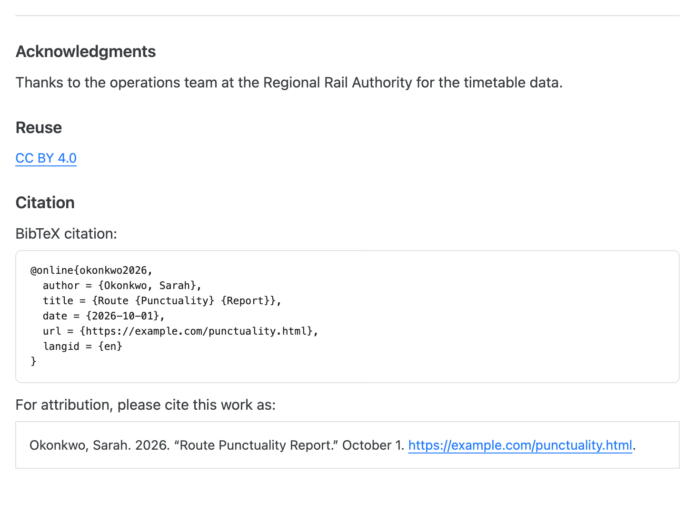{#fig-html-appendix-report .border fig-alt="An appendix below a horizontal rule with three sections. Acknowledgments contains one sentence. Reuse contains a link reading CC BY 4.0. Citation contains a BibTeX entry for Okonkwo 2026 in a code block, then the line For attribution, please cite this work as, followed by Okonkwo, Sarah. 2026. Route Punctuality Report. October 1, and the URL."}


## Code blocks {#sec-html-code-blocks}

When you include a code block, it will get automatic syntax highlighting based
on the language you specify.
For example, here's a code block specified as `r`:

````{.markdown filename="report.qmd" .code-overflow-wrap}

````

In the HTML, the block gets R syntax highlighting as shown in @fig-html-code-blocks-highlight.
Executable code cells that are echoed in your document get the same treatment, so your code is styled consistently.

{#fig-html-code-blocks-highlight .border fig-alt="A sentence followed by an R code block with colored syntax highlighting on a light grey background."}

The default highlighting theme is `arrow`.
Pick a different one with `syntax-highlighting`:

```{.yaml filename="report.qmd"}
---
format:
  html:
    syntax-highlighting: github
---
```

Supported themes include: `a11y`\*, `arrow`\*, `pygments`, `tango`, `espresso`, `zenburn`, `kate`, `monochrome`, `breezedark`, `haddock`, `atom-one`\*, `ayu`\*, `breeze`\*, `dracula`, `github`\*, `gruvbox`\*, `monokai`, `nord`, `oblivion`, `printing`, `radical`, `solarized`, and `vim-dark`.

The themes with asterisks have light and dark variants designed for use on light and dark backgrounds respectively.
Specify only the theme name and Quarto will switch between them automatically. 
To specify a variant explicitly add a `-light` or `-dark` suffix.

### Filename

Adding a filename to a code block can provide additional context about where code goes for a reader. 

Add one with the `filename` attribute:

````{.markdown filename="report.qmd" .code-overflow-wrap}

````

The filename renders as a label on the code block, as shown in @fig-html-code-blocks-filename.

{#fig-html-code-blocks-filename .border fig-alt="A sentence followed by a syntax-highlighted R code block with a darker grey header bar labelled analysis.R."}

::: callout-tip

## Filename doesn't need to be a filename

You can put any string in `filename` so it doesn't necessarily have to be a filename. 
We often use `"R Console"`, or `"Terminal"` in teaching settings to make it clear where learners should be writing and executing code.
:::

### Other code features {#sec-html-code-features}

There are other code block features that are unique to HTML (and other HTML based formats like `revealjs`).
It's useful to know these exist but we point you to the documentation for the details and relevant options:

* **Copy button**: Every code block gets a button to copy its contents to the clipboard.
  The button appears when a reader hovers over the block (@fig-html-code-features-copy-button).
  You don't need to do anything to get it, but you can turn it off or keep it always visible with the `code-copy` document option.
  Read more in the [Copy Button](https://quarto.org/docs/output-formats/html-code.html#copy-button) section of the Quarto documentation.

  {#fig-html-code-features-copy-button .border fig-alt="A code block of R code with a clipboard icon in its top right corner."}

* **Code folding**: Set the document option `code-fold: true` to hide the code of executable cells behind a "Code" toggle, so readers see the output first and expand the code only if they want it (@fig-html-code-features-code-fold).
  Read more in the [Folding Code](https://quarto.org/docs/output-formats/html-code.html#folding-code) section of the Quarto documentation.

  {#fig-html-code-features-code-fold .border fig-alt="A collapsed toggle labelled Code above a printed data frame of three routes and their peak and off-peak on-time rates."}

* **Code tools**: Set document option `code-tools: true` to add a "Code" menu next to the document title.
  The menu lets readers show or hide all the code at once, and view the source of the whole document (@fig-html-code-features-code-tools).
  Read more in the [Code Tools](https://quarto.org/docs/output-formats/html-code.html#code-tools) section of the Quarto documentation.

  {#fig-html-code-features-code-tools .border fig-alt="A document titled Route Punctuality Report with an open menu next to the title. The menu has the items Show All Code, Hide All Code, and View Source."}

* **Code annotation**: Add numbered markers to lines of code and explain each line in a numbered list below the block (@fig-html-code-features-code-annotation).
  Code annotation also works in other formats, but in HTML you can also show the explanations as a tooltip when a reader hovers over a marker.
  Read more on the [Code Annotation](https://quarto.org/docs/authoring/code-annotation.html) page of the Quarto documentation.

  {#fig-html-code-features-code-annotation .border fig-alt="A code block of three lines of R code, each with a circled number at the end. Below the block, a numbered list explains each line."}

## Tabsets {#sec-html-tabsets}

A tabset shows several panels of content in the same space, one at a time.
Readers click a tab to switch between panels.
Tabsets work best for alternatives where a reader only needs to see one: the same code in R and Python, instructions for different operating systems, or details for different routes.

To create a tabset, put your content in a fenced div with the class `.panel-tabset`:

````{.markdown filename="report.qmd" .code-overflow-wrap}

````

Headings inside the div start new tabs, and the heading text becomes the tab label.

The result is shown in @fig-html-tabsets-route-tabs.

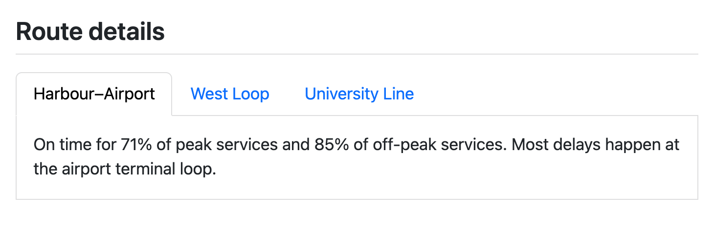{#fig-html-tabsets-route-tabs .border fig-alt="A section titled Route details with three tabs labelled Harbour–Airport, West Loop and University Line. The Harbour–Airport tab is selected and shows two sentences about its on-time rates."}

::: callout-note
## Tabsets are best in HTML formats

Tabsets are inherently an HTML feature. 
In static formats like PDF and MS Word, all tabs will be rendered one after another, with no interactive switching. 
:::

### Linking tabsets with `group`

When your document has more than one tabset with the same tabs, give each of them the same `group` attribute:

````{.markdown filename="report.qmd" .code-overflow-wrap}

````

Now, when a reader selects "West Loop" in one tabset, every tabset in the `route` group switches to "West Loop" too.
The reader's browser also remembers the choice, so the same tab is selected when they come back to the page, or move to another page in the same website.

## Mathematical equations {#sec-html-math}

You write equations for HTML the same way as for any other format: with TeX math syntax.
Use single dollar signs (`$...$`) for inline math, and double dollar signs (`$$...$$`) for display equations:

````{.markdown filename="report.qmd" .code-overflow-wrap}

````

The result is shown in @fig-html-math-equations.

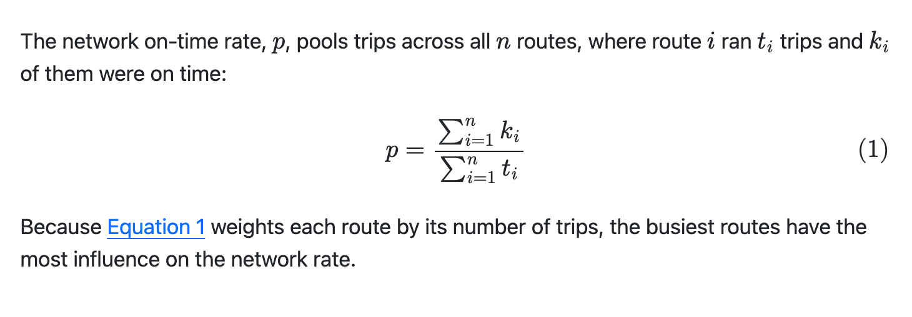{#fig-html-math-equations .border fig-alt="A sentence with inline symbols p, t sub i and k sub i, then a centered display equation for the network on-time rate as a ratio of two sums, numbered (1) at the right margin, then a sentence with a link to Equation 1."}

Like other cross-references in HTML, readers can hover over the link to `@eq-network-rate` to see a preview of the equation.

You can read more about writing equations, including cross-references and defining your own commands, in @sec-equations.

### Math rendering methods

By default, Quarto uses [MathJax](https://www.mathjax.org/), a JavaScript library that typesets the math in the reader's browser.
MathJax supports almost all common TeX math commands, and it makes equations available to screen readers.

MathJax loads from the web, so readers who are offline won't see typeset math.
If that matters, set `html-math-method: mathml`.
MathML is a markup language for math that browsers display without JavaScript, but it supports fewer TeX commands:

```{.yaml filename="report.qmd"}
---
format:
  html:
    html-math-method: mathml
---
```

For other methods, see [LaTeX Equations](https://quarto.org/docs/output-formats/html-basics.html#latex-equations) in the Quarto documentation.

## Citations {#sec-html-citations}

Citations require a bibliography file holding reference metadata. 
A common format for this is BibTeX (`.bib`):

```{.bibtex filename="references.bib"}

```

To cite an item in the bibliography, specify the bibliography file in `bibliography` and use the `@` syntax in your text:

````{.markdown filename="train-punctuality.qmd" .code-overflow-wrap}

````

The citation renders in the text, and Quarto adds a References section in the Appendix at the end of the document, as shown in @fig-html-citations.

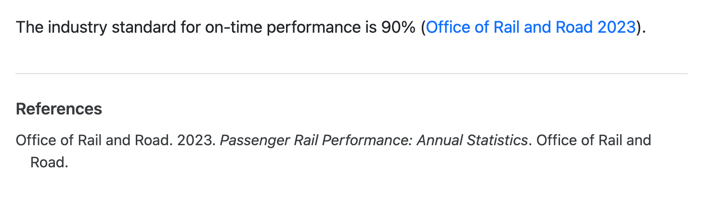{#fig-html-citations .border fig-alt="A sentence ending in the author-date citation (Office of Rail and Road 2023), followed by a References section with the full entry."}

Citations styles are specified by Citation Language Style (CSL) files. 
The [Zotero style repository](https://www.zotero.org/styles) provides a user friendly way to browse and download available styles maintained in the [citation-style-language/styles Github repository](https://github.com/citation-style-language/styles).

The default comes from Pandoc and is [`chicago-author-date`](https://www.zotero.org/styles/chicago-author-date) which corresponds to the Chicago Manual of Style, 18th edition, author-date style.

To use a different style, for example IEEE, provide a URL to the `csl` option:

````{.yaml filename="train-punctuality.qmd"}
---
format: html
bibliography: references.bib
csl: https://www.zotero.org/styles/ieee
---
````

Alternatively, download the `.csl` file and provide a path to the downloaded file.

The IEEE result is shown in @fig-html-citations-ieee.

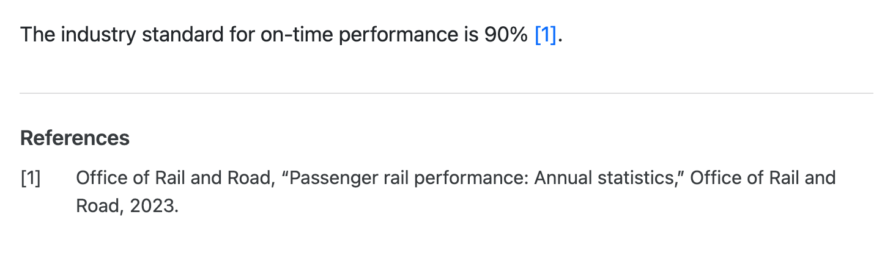{#fig-html-citations-ieee .border fig-alt="A sentence ending in the numbered citation [1], followed by a References section with the numbered entry [1], the title in quotation marks, and the year at the end."}

You can read more about citations in @sec-citations, including about various `@` syntax variations.

When readers hover over a citation in the text, they get a preview of the full citation (@sec-html-reference-popups).

## Computational outputs {#sec-html-computational-outputs}

Computational code cells work in `format: html` just as they do in other formats.
Outputs like figures, tables, and inline values are inserted into the document where the code cell was.

For example, here's a cell that produces a figure:

::: {.panel-tabset group="language"}
## R

````{.markdown filename="report.qmd" .code-overflow-wrap}
```{{r}}

```
````

## Python

````{.markdown filename="report.qmd" .code-overflow-wrap}
```{{python}}

```
````
:::

The figure appears directly below the surrounding prose with a numbered caption, as shown in @fig-html-computational-outputs-figures.

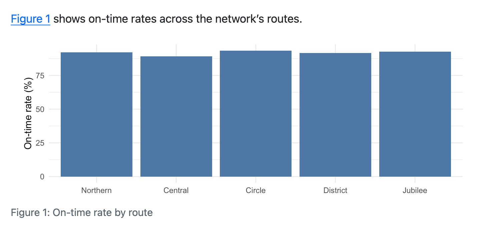{#fig-html-computational-outputs-figures .border fig-alt="A sentence with a link to Figure 1, followed by a bar chart of on-time rate by route, captioned Figure 1: On-time rate by route."}

You'll find the code cell options for captions, alternative text and cross-references, along with many more details about figures and tables from code, in @sec-figtab.

::: todo
[CVW] Link to light and dark versions of figures (`@sec-figtab-light-dark`) once it lands in the Figures and tables chapter. See #36 and branch `figtab-light-dark`.
:::

The sections below cover a few things that are specific to HTML: figure formats, table formats, and interactive widgets.

### Figure formats

The default figure format for HTML is `retina`.
This encodes both a default format, PNG, and that the image should be generated with twice as many pixels as its display size so it appears sharp on high-resolution screens.

Another reasonable format for HTML is SVG.
SVG is a vector format, so it scales without pixelation, however far a reader zooms in.
However, it can be slow to display when a figure contains many elements, like a scatterplot with thousands of points.
Set `fig-format` in the document header to switch the default format:

```{.yaml filename="report.qmd"}
---
format:
  html:
    fig-format: svg
---
```

You'll learn how to change the size of figures, along with other figure options, in @sec-figtab-computational.

### Table formats

Any code that produces a markdown or HTML table will result in a table in your HTML document.

Markdown tables are a good choice for simple tables. 
Markdown tables from code behave just like raw markdown tables you might write by hand with one exception: Quarto styles them a little differently.
Tables from code get shaded alternate rows and more compact spacing, so they can look different from a table you wrote by hand in the same document.

HTML tables are a better fit when you need more complicated table structure, like merged cells, hierarchical headers, or styling that depends on cell contents. 
HTML is also a common output for dedicated table packages.
Quarto keeps the structure of an HTML table: its rows, cells, merged cells, and any classes or inline styles on individual cells.
However, Quarto may change the `<table>` element itself, adding the same row shading and spacing as markdown tables, and removing any inline styles.
If your rendered table looks drastically different from the one you expected, Quarto's table processing is often the culprit.

Some Quarto-aware table packages will provide an option to turn this processing off. 
If the package you are using doesn't, and you'd like to, add the `html-table-processing` code option:

````{.markdown filename="document.qmd"}
```{{r}}
#| html-table-processing: none
# Code that produces an HTML table.
```
````

For general details about layout, labelling, etc., see @sec-figtab. 
For more details on computational tables, see @sec-figtab-tables. 

### Widgets

Many R and Python packages produce interactive outputs, like maps you can pan and zoom, plots that show values on hover, and tables you can sort and search.
These are often called **widgets**.

In HTML output, widgets usually just work: put the code that creates the widget in a code cell, and the rendered document includes the widget along with the JavaScript it needs.

For example, @fig-html-widgets-leaflet-code makes a map with the leaflet package in R and the ipyleaflet package in Python, and @fig-html-widgets-leaflet shows the result.

::: {#fig-html-widgets-leaflet-code}
:::: {.panel-tabset group="language"}

## R

````{.markdown filename="report.qmd"}


```{{r}}

```
````

## Python

````{.markdown filename="report.qmd"}


```{{python}}

```
````

::::

A code cell that makes an interactive map.
:::

::: {.content-visible when-format="html"}
:::: {#fig-html-widgets-leaflet .border}


```{r}
#| echo: false
#| fig-height: 3

```

An interactive leaflet map in an HTML document.
::::
:::

::: {.content-visible unless-format="html"}
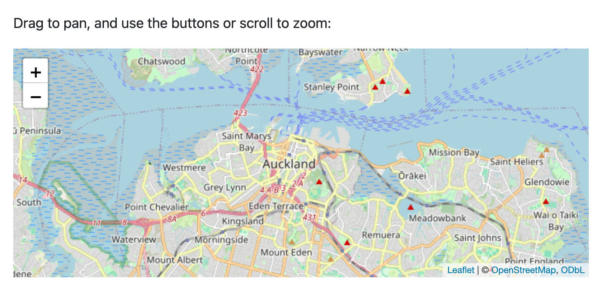{#fig-html-widgets-leaflet .border fig-alt="The sentence Drag to pan, and use the buttons or scroll to zoom, above a street map of central Auckland and its harbour. Zoom in and zoom out buttons are in the top left corner of the map, and a Leaflet and OpenStreetMap credit is in the bottom right corner."}
:::

You don't need to find widget packages with special Quarto support.
Quarto relies on the same mechanisms that display widgets in other places:

* In R, packages built on [htmlwidgets](https://www.htmlwidgets.org/), like leaflet, plotly, DT and reactable, work. So do most other packages that use htmltools to produce HTML.

* In Python, packages that display in Jupyter notebooks, like plotly, Altair, Bokeh and folium, work. So do [Jupyter Widgets](https://jupyter.org/widgets), like ipyleaflet.

There are some limitations to keep in mind:

* **Widgets run without R or Python.**
  Your code runs only when you render.
  In the rendered document, the widget's interactions happen in the browser, so anything that needs to run R or Python again won't work.

* **`embed-resources` might not be enough for offline readers.**
  Some widgets get their JavaScript libraries, or content like map tiles, from the web when they display, and Quarto can't embed these.
  If you share a self-contained file (@sec-sharing-other-ways) with readers who might be offline, open it without a connection to check your widgets.

* **Widgets are HTML only.**
  When you render to a static format like PDF you get a static version of the widget or nothing.
  With the knitr engine, rendering fails unless the webshot2 package is installed. If it is installed,  Quarto includes a screenshot of the widget.
  With the jupyter engine, you get a static image only if the package also provides one in its output bundle.
  If you render to more than one format, consider using conditional content to show a static plot or table in the other formats (see [Conditional Content](https://quarto.org/docs/authoring/conditional.html) in the Quarto documentation).

* **Widgets add weight and may not be accessible.**
  Each widget library adds JavaScript that readers must download.
  Not all widgets work with a keyboard or a screen reader, so give important results in the text too (see @sec-html-accessibility-interactive).

::: todo
[CVW] Consider moving to a "Computational outputs" chapter in the reorg.
:::

## Full width and margin content {#sec-html-page-layout}

On wide screens, your content appears in the middle of the page, in what Quarto calls the **body** column.
You can move content out of the body column with column classes.
For example, use might use `.column-margin` for a short aside: 

````{.markdown filename="report.qmd" .code-overflow-wrap}

````

Or give a wide table more room by applying `.column-page`:

````{.markdown filename="report.qmd" .code-overflow-wrap}

````

You can see the result of both in @fig-html-page-layout-columns.

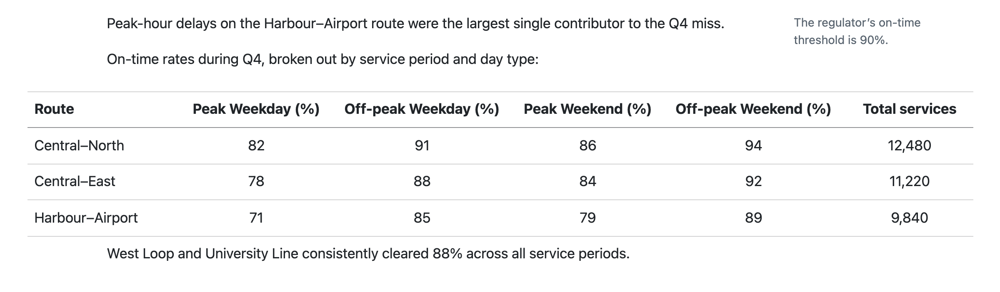{#fig-html-page-layout-columns .border fig-alt="Two lines of body text with a short grey note in the right margin, followed by a six-column table that extends past both edges of the body text, then a final line of body text."}

The full set of columns classes documented in [Article layout](https://quarto.org/docs/authoring/article-layout.html#available-columns) is available in HTML.

There are code cell and document options to place figures and tables in certain columns.
See @sec-page-columns for more details.

[Lightbox Figures](https://quarto.org/docs/output-formats/html-lightbox-figures.html) are another option for detailed figures, like maps or plots with many small labels, that are hard to read at body width.
Set `lightbox: true` to let readers click an image to see a larger view of it.
The larger view fills the browser window and includes the figure caption.

### Columns and responsive layout

You saw in @sec-html-responsive that HTML output is responsive to the size of a readers screen.
As a screen becomes narrower the column classes collapse.
Below 992px any classes that use it, lose their extra width on the left (@fig-html-page-layout-columns-medium). 

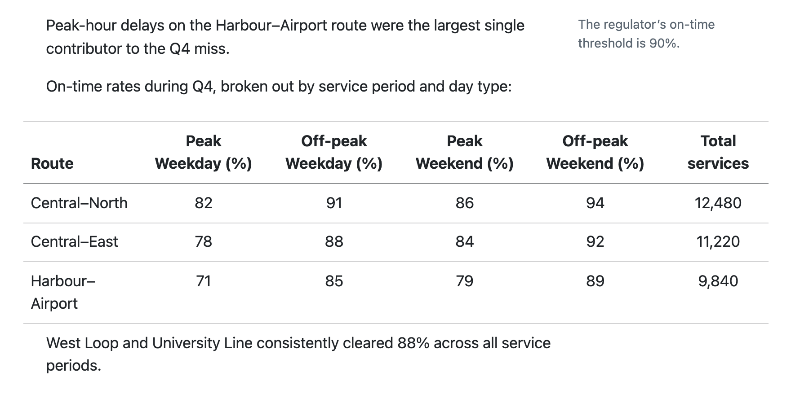{#fig-html-page-layout-columns-medium .border fig-alt="The same document in a medium-width window. The margin note is still in the right margin. The table still extends across the margin on the right, but only slightly past the left edge of the body text, and its column headers wrap onto two lines." width="75%"}

Below 768px everything except `.column-screen` is body width, and margin content moves inline (@fig-html-page-layout-columns-narrow).

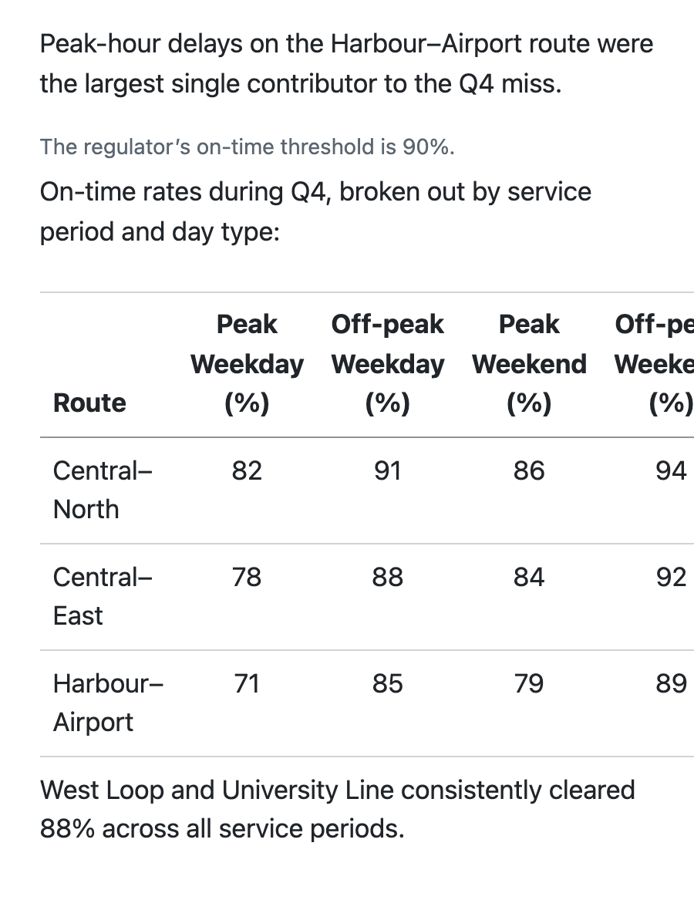{#fig-html-page-layout-columns-narrow .border fig-alt="The same document in a narrow window. The margin note appears in grey between the first and second paragraphs. The table is the same width as the text and its right columns are cut off." width="50%"}

When margin content or wide content overlaps with the table of contents, the table of contents collapses to a button (@fig-html-page-layout-toc-overlap).

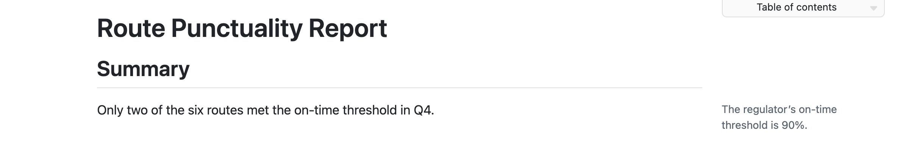{#fig-html-page-layout-toc-overlap .border fig-alt="A document title, a Summary heading, and a sentence. A grey note is in the right margin. Above it, at the top of the margin, is a small button labelled Table of contents with a down arrow, in place of the full list of sections."}

If you are using column classes, it's a good idea to check your layout at a narrow device width and verify your content makes sense when the columns collapse. 

You can also put footnotes, citations, and figure captions in the margin (@sec-column-classes).
To change the width of the body and margin columns, use the `grid` option (@sec-html-grid).

## Raw HTML {#sec-html-raw-html}

If you want to include HTML syntax that propagates as-is to the final HTML file use a raw HTML block.
For example, HTML has a [`<meter>`](https://developer.mozilla.org/en-US/docs/Web/HTML/Reference/Elements/meter) element for displaying a value in a known range.
There is no equivalent Quarto markdown syntax that creates this element.
To use one in your Quarto document, use the HTML syntax inside a raw HTML block:

````{.markdown filename="report.qmd" .code-overflow-wrap}

````

{#fig-html-raw-html-meter .border fig-alt="A heading reading Peak on-time rate above the label Coastal Express and a horizontal gauge about two-thirds full in red."}

Another common use is to embed an iframe.
Iframes are windows onto other web pages: an [`<iframe>`](https://developer.mozilla.org/en-US/docs/Web/HTML/Reference/Elements/iframe) element displays another page inside a rectangle on your page, and readers can interact with it as if they had visited that page.
Two common uses are to embed an app, e.g. a Shiny app, hosted on another site, or embed HTML slides like those covered in @sec-presentations.
There is no native syntax, so it belongs in a raw HTML block. 
Here's an example that uses an iframe to embed a map hosted on `openstreetmap.org`:

````{.markdown filename="report.qmd" .code-overflow-wrap}

````

It's also common for other projects to provide HTML you can copy and paste to your own sites. 
For example, the [Creative Commons (CC) chooser](https://creativecommons.org/chooser/) provides an HTML snippet to display and link a CC license. 
Copy the snippet and drop it in a raw HTML block:

````{.markdown filename="report.qmd" .code-overflow-wrap}

````

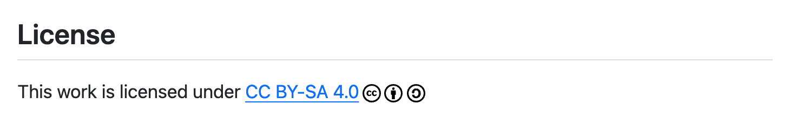{#fig-html-raw-html-license .border fig-alt="A heading reading License above the sentence This work is licensed under CC BY-SA 4.0, where CC BY-SA 4.0 is a link followed by the Creative Commons, Attribution and ShareAlike icons."}

If you need to add HTML to the `<head>` element, or are adding HTML to the start or end of your document, you should use one of the `include-` options covered in @sec-html-include. 

## Making accessible HTML {#sec-html-accessibility}

Accessibility is about increasing the reach of your documents.
An HTML document that's well-structured can be used by more people --- like readers who navigate with a screen reader, who zoom to 400%, or who use only a keyboard.

The [Web Content Accessibility Guidelines (WCAG)](https://www.w3.org/WAI/standards-guidelines/wcag/) are the most widely accepted standard for what counts as "accessible".
When a regulation says your document must be accessible, it almost always points to these guidelines.
WCAG was written for the web, so it applies directly to your HTML documents.
Assistive technologies, like screen readers, have supported HTML for decades.
That's one reason HTML is the best choice for accessible documents.

It's useful to think about the division of responsibility in creating accessible documents between Quarto and you.
Consider a section heading:

```{.markdown filename="report.qmd"}
## Methods of data collection
```

Quarto's responsibility is to translate this markdown into the correct HTML heading markup, so a screen reader announces it as a heading and a reader can jump to it.
Your responsibility is to:

- Use headings to structure your document into sections and subsections.
- Use the right syntax, `##` at the start of the line, so Quarto recognizes it as a heading.
- Use the right heading level, so the heading fits the structure of the rest of your document.
- Write a heading that accurately describes what's in the section.

In this section, you'll learn how to check your document automatically with `axe` (@sec-html-axe), and what passing those checks does and doesn't tell you.
Then you'll learn some best practices, including how to approach interactive content, and finally what to expect from the manual checks that automated tools can't replace (@sec-html-manual-checks).

### Check your document with `axe` {#sec-html-axe}

Some WCAG requirements are easily checked by automated tools.
Quarto includes one such tool, [axe-core](https://github.com/dequelabs/axe-core).
To run the default set of axe-core checks on your document and display the results on the rendered page itself set `output: document` under the `axe` option:

````{.markdown filename="report.qmd" .code-overflow-wrap}

````

When you preview the document, a report of the problems axe finds appears at the bottom of the page, as shown in @fig-html-axe-report.
Each problem in the report includes its severity, the WCAG level and success criterion it relates to, and a description of the problem.
Here, the figure's image has no alternative text, which fails WCAG 2.0 success criterion 1.1.1 (level A).

{#fig-html-axe-report .border fig-alt="A rendered HTML page titled Route Punctuality Report with a bar chart. Below the figure caption, a box across the bottom of the page reads: Critical, WCAG 2.0 A (1.1.1): Ensure img elements have alternative text or a role of none or presentation. Images must have alternative text. Below that is a link reading img."}

To fix this problem, you would add alternative text with the `fig-alt` attribute (see @sec-markdown-figures):

```{.markdown filename="report.qmd" .code-overflow-wrap}

```

When you preview again, the report says "No axe-core violations found."

The checks don't happen when Quarto renders your document.
Instead, Quarto adds axe to the page, and axe runs the checks in your browser when the page loads.
Your render won't fail if axe finds problems, it's your responsibility to open the page and look at the results.

::: callout-important
## Remove `axe` before you share

With `output: document`, the report is part of the page, so anyone who opens your document will see it.
Remove the `axe` option before you share your document.
In a project, you might instead put `axe` in a [project profile](https://quarto.org/docs/projects/profiles.html) that you only use while you work.
:::

By default, axe checks rules from several WCAG versions and levels, along with some of its own best-practice rules.
If you are working toward a specific WCAG version and level, set `standard`:

```{.yaml filename="report.qmd"}
format:
  html:
    axe:
      output: document
      standard: wcag22aa
```

Levels are cumulative, so `wcag22aa` checks the level A and AA rules for WCAG 2.2 and the earlier versions it builds on.
When you set `standard`, axe skips its best-practice rules.
Add `best-practice: true` to check them too.

The `axe` option can also send its results to your browser's developer console, or output them as JSON for automated tools.
Read more on the [HTML Accessibility Checks](https://quarto.org/docs/output-formats/html-accessibility.html) page of the Quarto documentation.

### What does it mean to pass `axe` checks?

Passing `axe` checks is a useful first step to ensuring an accessible document, but it doesn't mean your document is accessible.
Automated checks cover only part of WCAG.
Deque, the company behind axe-core, reports that automated testing found a little over half of the accessibility issues in its audits ([The Automated Accessibility Coverage Report](https://www.deque.com/automated-accessibility-coverage-report/)).

There are three big limitations to be aware of:

#### Checks can't judge whether content is meaningful {.unnumbered}

Many WCAG requirements need human judgment.
For example, consider success criterion 1.1.1:

> WCAG 2.2: 1.1.1 Non-text Content (Level A): All non-text content that is presented to the user has a text alternative that serves the equivalent purpose, except for the situations listed below. ...

An automated check can confirm that an image has alternative text, but it can't check that the text "serves the equivalent purpose".
Alternative text of "chart" passes the check, but tells your reader nothing about what the chart shows.
As a human, meeting requirements that need human judgment is your responsibility.

#### Checks only see one state of the page {.unnumbered}

The checks run once, when the page loads.
They see the page at one window width, in one color mode, and with interactive content in its initial state.
This means they may miss problems that only appear in another state, like in the content of a collapsed callout, a tabset panel other than the first, or your dark theme.

#### Checks can't interact with the page {.unnumbered}

Some WCAG requirements are about how a reader interacts with the page.
For example, a reader must be able to reach and use everything on the page with only a keyboard, move through it in a sensible order, and zoom in without content getting lost or cut off.
Automated checks look at the markup of the page, but don't interact with the page the way a reader does.
Evaluating these requirements requires manual testing by a person (@sec-html-manual-checks).

### Accessibility best practices

The following best practices will help you meet most WCAG AA requirements.
For each one, we note what `axe` can and can't check for you.

#### Use semantic structure

Your HTML needs to mark up content based on what it is, not how it looks: a section heading needs to be a heading element, not just big and bold text.
Quarto's markdown encourages this naturally --- when you write `## Recommendations`, Quarto knows it is a second-level heading and produces an `<h2>` element.
Avoid raw HTML or styled text that only looks like a heading.

Your document's `title` becomes the only first-level heading on the page, so start the headings in your document body at `##`.
Be careful not to skip heading levels, e.g., jumping from `##` to `####` without an intervening `###`.
Skipping levels can make navigation difficult for screen reader users.
`axe` flags skipped heading levels as a best-practice problem, so you'll only see it if you haven't set `standard`, or you've set `best-practice: true`.

#### Communicate a logical reading order

Quarto encourages this naturally too: the reading order is the same as the top-to-bottom order of elements in your `.qmd`.
This is true even when the layout moves content visually.
For example, content you place in the margin (@sec-html-page-layout) appears beside the body on wide screens, and inline with the body on narrow ones, but a screen reader always reaches it in the position it has in your `.qmd`.
As long as you write your `.qmd` to read from top-to-bottom, you'll meet this requirement.

#### Set required metadata

The `title` in your document header sets the `<title>` of the page, which browsers show in the tab and screen readers announce when the page opens.
The `lang` option sets the language of the page, so a screen reader knows how to pronounce your text.

Always set `title`, and if your document is written in a language other than English, set `lang` appropriately.

If a phrase is in a different language from the rest of your document, mark it with a span and a `lang` attribute, like `[bonjour]{lang="fr"}`.

#### Provide alternative text for all images

`axe` will flag images without alt text --- but you still need to write meaningful descriptions yourself.
Add alt text with the `fig-alt` attribute or code cell option (see @sec-markdown-figures).

If an image is purely decorative and adds nothing to the content, set `fig-alt=""`.
Empty alt text tells a screen reader to skip the image, and passes the `axe` check.

You don't need to add alt text to equations.
With the default `html-math-method`, MathJax generates spoken text for each equation, and lets readers explore an equation part by part with a keyboard.

#### Use informative titles, headings, alternative text, and link text

No automated check can tell whether a field's content is meaningful --- only that the field is set.
"My document", "Section 4", "chart", or "click here" pass every automated check and leave your reader with nothing to navigate by.
It's your responsibility to ensure these accurately describe their content.

#### Use color choices that are readable {#sec-html-accessibility-color}

There must be sufficient contrast between foreground and background, both in textual elements (body text, headings, code blocks, syntax highlighting, etc.) and in any parts of a figure important for understanding it (points, bars, lines, key icons, etc.).
Meaning shouldn't depend on color alone --- supplement with labels, patterns, or shape.

`axe` checks the contrast of most text on the page, so it will catch problems from your theme or brand colors (@sec-html-customizing-appearance).
If you use both a light and a dark theme, check the page in each mode, since `axe` only checks the one it loads in.
The default syntax highlighting theme, `arrow`, is designed for accessibility, as is `a11y`.

`axe` can't check text or colors inside an image, like the labels and bars of a plot.
It also can't tell when meaning depends on color alone.
These are your responsibility.

#### Give tables header rows and captions

A header row lets a screen reader tell a reader which column a cell belongs to.
Add captions to tables (see @sec-markdown-tables).
Markdown tables get a header row automatically but tables from code depend on the package that makes them. 
Check that the header cells come through as headers.

Avoid using tables just to lay out content side-by-side.
Use the panel layout attributes instead (@sec-layout-panel). 

#### Be wary of interactive content {#sec-html-accessibility-interactive}

How accessible an interactive output is, like a widget (@sec-html-computational-outputs), depends on the library that makes it, not on Quarto.
Many widgets are hard or impossible to use with a keyboard or a screen reader, and `axe` only sees a widget in its state when the page loads.
Before you add interactivity, ask whether your reader needs it.
If they do, give them an equivalent, like a summary of the main results in the text, a table of the data, or a static figure with alt text.

### Manual checks {#sec-html-manual-checks}

Automated checks like `axe` aren't enough to show your document meets an accessibility standard: some requirements can only be checked by a person.
If your document needs to meet a standard, for example, to comply with a regulation, expect it to get manual checks too.
These might come from an accessibility team's audit or an outside reviewer, or you might be asked to do them yourself.
Typical checks include using the page with only a keyboard, zooming to 200% and 400%, viewing the page on a narrow screen, and reading the page with a screen reader.

Quarto is responsible for the parts of the page it generates, like the table of contents, tabsets, code blocks, and the responsive layout.
If a manual check finds a problem in one of these parts, it's a bug in Quarto, and it isn't your job to fix it.
Instead, look for the problem in [Quarto's issues](https://github.com/quarto-dev/quarto-cli/issues), and report it if it isn't already tracked.

Pay close attention to widgets, like interactive plots and tables (@sec-html-accessibility-interactive).
Quarto doesn't control the markup that R and Python packages produce, so widgets are a common source of problems in manual checks.
For example, a reader using a keyboard may not be able to reach the controls that zoom a plot or sort a table, and a screen reader may announce a plot as an unlabeled graphic, or skip it entirely.
Widgets can also break when a reader zooms in, with controls that overlap or get cut off.

If you're doing the checks yourself, two are quick to start with.
Press Tab repeatedly to move through the page, and check that you can reach every link and control, and can always see where you are.
Then zoom your browser to 200%, and check that nothing is cut off or overlaps.

## Customizing appearance {#sec-html-customizing-appearance}

In this section you'll learn basic ways to change how your HTML document looks with theming: the colors, fonts, borders and space on your page.

There are three levels of customization. 
Each gives you more control than the one before:

1. A built-in theme, set with `theme` (@sec-html-themes).
2. Your own colors and fonts, set with `brand` (@sec-html-brand).
3. Your own CSS rules, added with `css` (@sec-html-css).

This section covers what we think are the most useful tweaks for a single document.
We delay more in-depth coverage of theming to @sec-websites-theme on Websites.
There you'll learn about dark mode, how to combine **brand.yml** with a built-in theme, how to write SCSS, and the role of Bootstrap.
Everything in that section also works for a single document except you'll put the options in your document header, not in `_quarto.yml`.

### Built-in themes {#sec-html-themes}

The easiest way to change the appearance of your document is to use one of the 25 [Bootswatch](https://bootswatch.com) themes included with Quarto.
To use one, set `theme` in the document header:

```{.yaml filename="report.qmd"}

```

The result is shown in @fig-html-themes-flatly.

{#fig-html-themes-flatly .border fig-alt="The Route Punctuality Report in the flatly theme: a bold sans-serif title and On-time performance heading in dark grey, a sentence with a teal-green underlined link, and a table of three routes with peak and off-peak on-time rates, separated by thin grey lines."}

If you don't set `theme`, you get the theme `default`.
The available themes are: `default`, `cerulean`, `cosmo`, `cyborg`, `darkly`, `flatly`, `journal`, `litera`, `lumen`, `lux`, `materia`, `minty`, `morph`, `pulse`, `quartz`, `sandstone`, `simplex`, `sketchy`, `slate`, `solar`, `spacelab`, `superhero`, `united`, `vapor`, `yeti`, and `zephyr`.

### Colors and fonts with **brand.yml** {#sec-html-brand}

Sometimes just tweaking a few colors and the font is enough to give your document your own style.
The easiest way to do this in Quarto is through [**brand.yml**](https://posit-dev.github.io/brand-yml/).
For a single standalone document the easiest way to use brand.yml is to set colors and fonts with the `brand` document option. 

For example, the three colors that have the most effect on a document are `foreground` (the text color), `background` (the page color), and `primary` (the accent color):

```{.yaml filename="report.qmd"}

```

The result is shown in @fig-html-brand-colors.

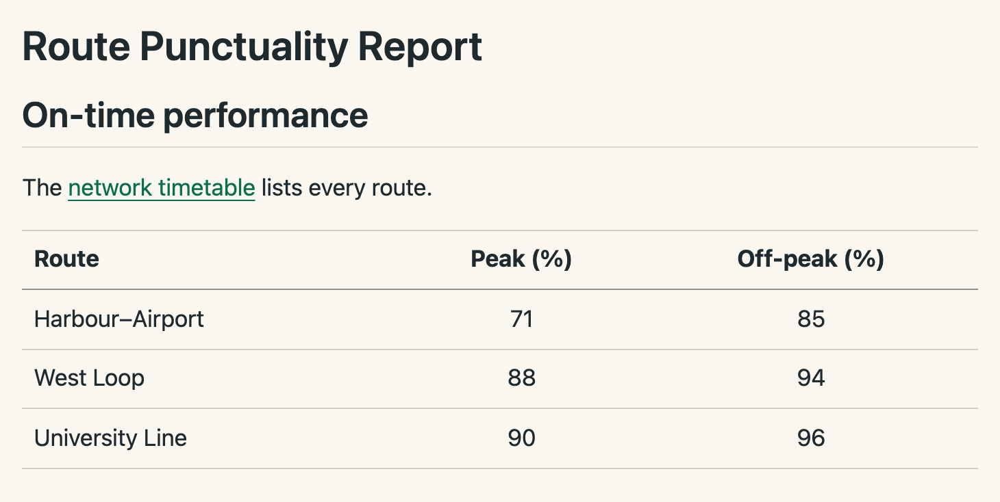{#fig-html-brand-colors .border fig-alt="The Route Punctuality Report on a warm off-white background: a title and On-time performance heading in dark slate text, a sentence with a dark green underlined link, and a table of three routes with peak and off-peak on-time rates, separated by thin grey lines."}

You can set fonts under the `typography` key. 
One available source is [Google Fonts](https://fonts.google.com)
List the font in `fonts`, then use `base` to set the font for the document:

```{.yaml filename="report.qmd"}

```

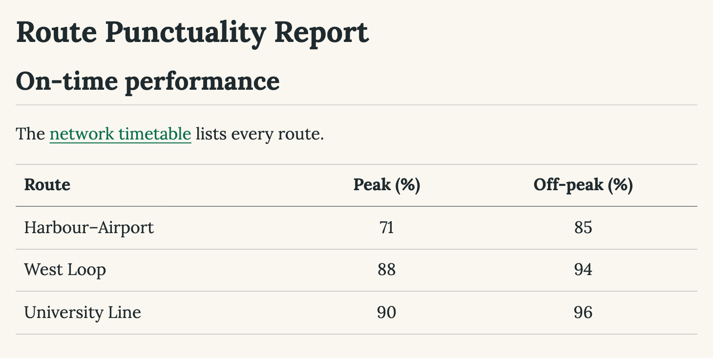{#fig-html-brand-fonts .border fig-alt="The Route Punctuality Report with the same colors as the previous figure. All the text, including the title, the On-time performance heading, the sentence with a dark green link, and the table of three routes, is in a serif font."}

Change `source: google` to `source: bunny` if you prefer [Bunny Fonts](https://fonts.bunny.net), a GDPR-compliant alternative to Google Fonts.

**brand.yml** has many more options.
You can read about them in @sec-websites-theme, and in the Quarto documentation [Guide to using **brand.yml**](https://quarto.org/docs/authoring/brand.html).
To use a brand together with a built-in theme, see @sec-brand-theme.

### Custom CSS {#sec-html-css}

A theme or brand give big appearance changes, but if you need more control over individual elements you can also write your own CSS rules.
CSS (Cascading Style Sheets) is the language that browsers use to style HTML.
A CSS rule has a selector, which identifies the elements to style, and declarations, which set the style.

For example, by default Quarto puts a thin line under each level 2 heading.
This rule removes the line:

```{.css filename="styles.css"}

```

To add the rule to your document, save it in a file and give the path to the file in `css`:

```{.yaml filename="report.qmd"}

```

Quarto's themes are written in SCSS, a language that extends CSS with features like variables.
You can also add your own SCSS file with `theme`.
This lets you change Quarto's variables in one place.
You can learn how in @sec-websites-theme.

## Advanced customization {#sec-html-advanced-customization}

### Column widths {#sec-html-grid}

Quarto lays out an HTML page on a grid of columns: sidebar, body, and margin.
The `grid` option sets the widths of these columns and the gutters between them.
@fig-html-grid-anatomy shows the options on the layout for a document with a table of contents or other content in the right margin, at three screen widths.

{#fig-html-grid-anatomy .border fig-alt="Three browser windows of decreasing width, each with a gray block labelled .column-body, a pink block labelled .column-margin, and a blue block labelled .column-page. In the widest, brackets mark body-width over the body column, gutter-width over the gap between body and margin, margin-width over the margin column, and a dashed sidebar-width over the short distance the .column-page block extends left of the body. In the middle window, the margin column remains but the .column-page block no longer extends left of the body. In the narrowest window, everything is in one column, with the .column-margin block above the body."}

| Option          | Default | Controls                                                                                   |
|:----------------|:--------|:-------------------------------------------------------------------------------------------|
| `body-width`    | 800px   | The body column                                                                            |
| `margin-width`  | 250px   | The margin column, where margin content and the table of contents go                       |
| `gutter-width`  | 1.5em   | The space between the body and the margin column, and at the edges of the page             |
| `sidebar-width` | 250px   | How far content with a class like `.column-page` extends to the left of the body          |

Think of the column widths in `grid` as maximums: a column is this wide when there's room, and narrower when there isn't.

For example, to make the body column wider:

```{.yaml filename="report.qmd"}

```

The layout depends on what is next to the body:

* If your document has no table of contents and no margin content, there is no margin column, and `margin-width` has no effect.

* If you set `toc-location: left`, the table of contents goes in a column on the left, and `sidebar-width` sets the width of that column.
  This sidebar column gets preference over the margin column,
  so it collapses inline last..

### Including HTML with `include-` options {#sec-html-include}

The `include-` options take raw content and insert it, without processing, at a fixed place in your HTML output:

| Option                | Where the content goes                                | Typical use                                                                                        |
|:----------------------|:------------------------------------------------------|:---------------------------------------------------------------------------------------------------|
| `include-in-header`   | The end of `<head>`                                   | `<meta>` tags, `<script>` tags that load a JavaScript library from a CDN, or third-party snippets like analytics |
| `include-before-body` | The start of the main content, before the title block | A banner, like a "Draft" notice                                                                    |
| `include-after-body`  | The end of `<body>`, after the main content           | A footer, or scripts that need the page loaded                                                     |

As an example, consider requesting your page not be indexed by search engines.
The usual approach is to add a specific `meta` tag to the header:

````{.yaml filename="report.qmd"}

````

Notice the snippet itself is passed in the header to the `text` subkey.
This works well for short snippets, but you can instead provide a path to a file that holds your snippet.
For example, if you've stored the CC snippet from @sec-html-raw-html in `license.html`:

```{.html filename="license.html" .code-overflow-wrap}

```

You can include it at the end of your content with:

````{.yaml filename="report.qmd"}

````

### Custom title block {#sec-html-partials}

In @sec-html-title-block you saw document options you set than populate the title block that sits at the top of your document.
If you want to include additional fields in this block, or customize its structure, you'll need to provide your own **template partial**.

A complete discussion of partials and templates is beyond the scope of this book, but we'll work through a small example of adding a "Report Status" item to the title block to give you a feel for the kind of customization available.

First, a little about how your source ends up as an HTML document.
When you render, Quarto translates your markdown to HTML, but that translated content isn't a complete page on its own.
Quarto wraps it in boilerplate from a **template**.
For HTML this template is a file called `template.html`.
The template is broken into small pieces, the **partials**, that the template includes in order.
Here is a simplified version of `template.html`, with most of its content replaced by `...`:

```{.html filename="template.html"}

```

The placeholder `$body$`, nested inside the HTML tags `<html>` and `<body>`, is where the content from your `.qmd` goes after its translated.
The title block comes from the partial `title-block.html`, included in the template with `$title-block.html()$` 
a few lines before `$body$`.

Quarto lets you replace one partial with your own copy without touching the rest of the template.
A common workflow is to start from the default template and edit it.

Here is a simplified version of the default `title-block.html`:

```{.html .code-overflow-wrap filename="title-block.html"}

```

The dollar signs (`$`) signal Pandoc's template syntax. 
In particular, they are used to pull in values from the document metadata, e.g., `$title$` is replaced with the value of `title` from your document header.
Everything else is HTML that goes into the output as written.
You can read more about this syntax in the [Pandoc manual](https://pandoc.org/MANUAL.html#template-syntax).

In plain language the part of the partial we've highlighted says:

* If `title` is set, add it inside an H1 heading with the class `title`, then
* if `subtitle` is set, add it inside a paragraph with the classes `subtitle` and `lead`.

::: callout-note

## Partials and templates change over time

We've documented the template and partials as of the time of writing, but they can change as Quarto evolves.
To see the template and partials for your version of Quarto, look at their source in the [`quarto-cli` repo](https://github.com/quarto-dev/quarto-cli/) at <https://github.com/quarto-dev/quarto-cli/tree/v1.11.9/src/resources/formats/html/templates>, replacing `v1.11.9` with your version of Quarto.

There is more than one `title-block.html`.
The default title block comes from `templates/title-block.html`.
But, if you set `title-block-banner` Quarto uses the partial in `templates/banner/`.

:::

To add a field to the title block, start by adding it to the document header.
This example uses `report-status`, a key that Quarto doesn't use itself:

```{.yaml filename="report.qmd"}

```

The `template-partials` option tells Quarto to use your copy of `title-block.html`, from the same folder as `report.qmd`, in place of the default.

Next, copy the default `title-block.html` into your project.
After the subtitle, add three lines that follow the same pattern as the subtitle:

```{.html filename="title-block.html"}

```

When rendered, the status shows under the title (@fig-html-partials-report).

{#fig-html-partials-report .border fig-alt="A title block with the heading Route Punctuality Report, the line Status: Provisional below it in plain text, and then a small grey label reading Author above the name Sarah Okonkwo."}

Notice we set a class on the new paragraph but otherwise did no styling: there are no colors, sizes, or positions.
It's good practice to keep content and style separate: the partial controls *what* is in the title block, and a stylesheet controls how it looks.
To style the status, you would add a rule for `.report-status` to a CSS file (@sec-html-css), or an SCSS file (@sec-websites-theme).

If you use the same partial in many projects, or want to share it, you can bundle it into a format extension.
Read more in the Quarto documentation on [Custom Formats](https://quarto.org/docs/extensions/formats.html).

## Sharing HTML {#sec-html-sharing}

In order for someone else to see your rendered HTML document exactly as you do, they need all of the files it depends on.
This includes the automatically generated CSS and Javascript files, along with any local files, like images, you might have included.

You have two options:

* Publish the document to the web and share a URL.
* Embed all the supporting files in a single self-contained HTML file and share that file.

### Publish and share a URL {#sec-html-sharing-publish}

The easiest option is to publish your document with `quarto publish`, as you saw in @sec-sharing:

``` {.bash filename="Terminal"}
quarto publish report.qmd
```

Quarto renders your document, finds all the files that it needs, and uploads them to the provider that you select.
The provider serves the files from a web server.
You share a URL, and your readers only need a web browser.
For most documents, this is the best option.
Readers get all the features in this chapter, and you can easily update the content at the same URL by running `quarto publish` again.

### Self-contained HTML {#sec-sharing-other-ways}

If you want to share a single file, i.e., as an email attachment, you can embed all the resources in your rendered document by setting the `embed-resources` option to `true`:

``` {.yaml filename="document.qmd"}
---
title: Self Contained HTML
format:
  html:
    embed-resources: true
---
```

When you render, Quarto embeds the supporting files directly in the output `.html` file.
Your readers usually open the file directly in their browser. 
The limitations mentioned in @sec-html-preview don't apply because the JavaScript modules are no longer external resources.

If your document contains math, and you might view it offline, add `self-contained-math: true` to ensure the math libraries are also embedded (by default they aren't because they are quite large):

``` {.yaml filename="document.qmd"}
---
title: Self Contained HTML
format:
  html:
    embed-resources: true
    self-contained-math: true
---
```

## Wrapping up

In this chapter, you learned what's specific to HTML: how to view it, how it responds to the reader, and how to structure, check, customize, and share a standalone document.
Most of what you write in an HTML document isn't specific to HTML, though.
The markdown syntax for content like figures, tables, cross-references, and callouts is covered in @sec-authoring, and works across formats.

There's plenty more you can do with `format: html` that we didn't cover.
For more features, see the HTML pages in the [Quarto Guide](https://quarto.org/docs/output-formats/html-basics.html), and for the full set of document options, see the [HTML format reference](https://quarto.org/docs/reference/formats/html.html).

When one document isn't enough, head to @sec-websites to learn how to combine HTML documents into a website, with shared navigation, search, and theming.
