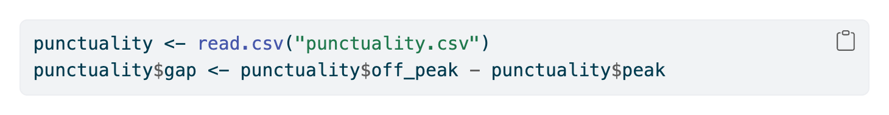
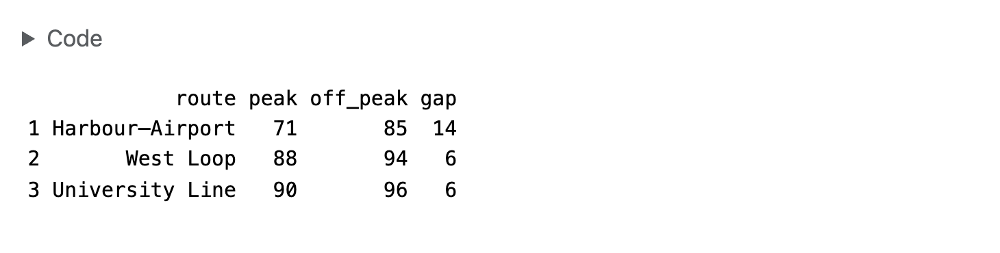
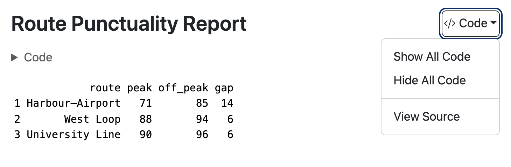
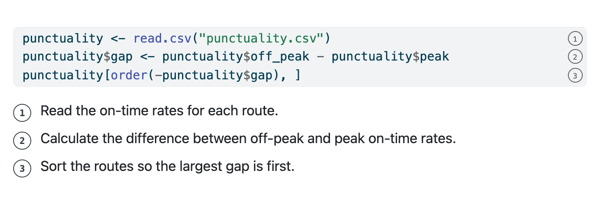
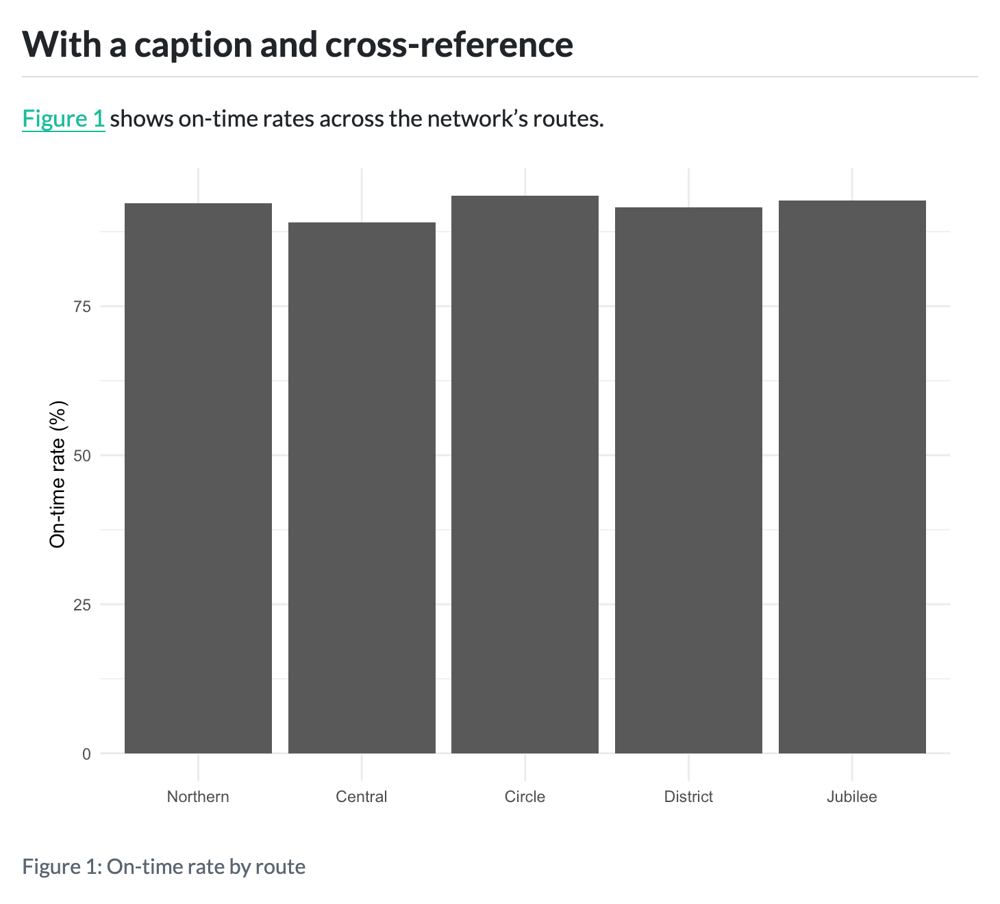
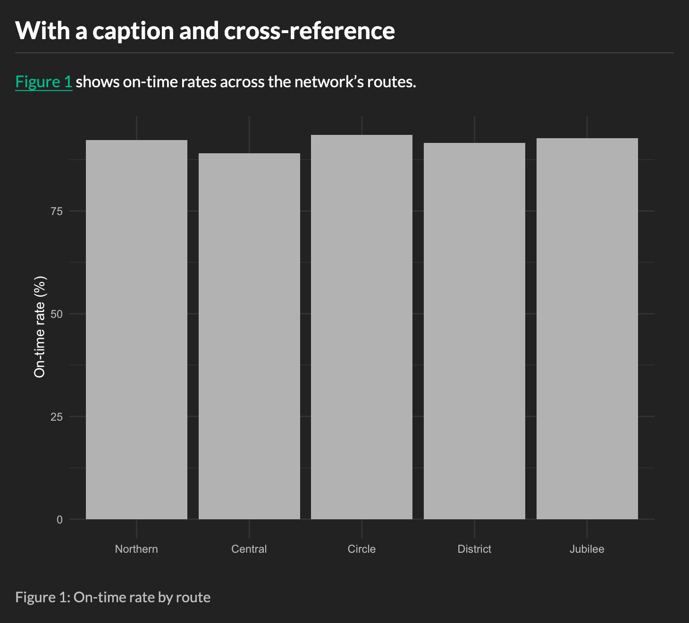

# HTML {#sec-html}

## Overview

This chapter covers HTML documents, the default format in Quarto.
There are good reasons HTML is the default:

* It renders fast: a quick edit-preview cycle means you can iterate on your document without friction.

* It displays almost anywhere: all that a reader needs is a web browser, available on desktops, Chromebooks, tablets and mobile devices. 

* It's one of the most accessible formats: HTML has a long history of support from assistive technologies and guidelines, like the WCAG, exist for authoring accessible HTML.

Here we focus on `format: html` for single standalone documents. 
However, HTML documents are also the building blocks of websites, where each HTML document becomes a webpage. 
Read this chapter to learn about what goes on a web page, and head to @sec-websites to learn how to combine them into a website.

For standalone documents where you want content to appear exactly the same for every viewer, or you need to conform to a  "paged" layout, PDF may be a better option.
PDF viewers are also widely available, but have a shorter history of supporting assistive technology. 
You can learn more about creating PDFs in @sec-typst.

::: todo
General outline of chapter.
:::

## Your first HTML document {#sec-html-first-document}

Since HTML is the default format in Quarto, you've already worked with a few HTML documents. 
But, to be concrete, here's a short but complete example, with some common content types:

````{.markdown filename="train-punctuality.qmd" .code-overflow-wrap}

````

Since `html` is the default format, you could omit `format: html`, and still get HTML output.

When rendered the result is `train-punctuality.html`, shown in @fig-html-first-document-train-punctuality.

{#fig-html-first-document-train-punctuality .border fig-alt="A rendered HTML page showing a Route Punctuality Report with a table of on-time rates by route and a recommendations section."}

::: {.callout-note}
## Preview, don't open

When you call `quarto preview` on an document targeting `format: html`, there are two steps Quarto takes. 
First, it renders the document, then it serves it with a local webserver. The preview you see comes from pointing your browser at this webserver: you'll see the URL starting with something like `http://localhost`.

This is subtly different from rendering your document and opening the resulting `.html` file in your browser.
If you do that, you'll see the URL starts with `file://`.

When browsers open a file from a `file://` address they often restrict restrict what it can do.
For example, Chrome refuses to load JavaScript modules from a `file://` address.
Since some Quarto features are implemented as JavaScript modules, when you view view a `file://` page in these browsers you may lose functionality.

Some features you might lose include:

* a highlight of the current section in the table of contents,
* the table of contents hiding when it overlaps with margin content, and
* tabsets in the same `group` switching together.

In general, you'll always want to examine your rendered document from the preview, not open the resulting `.html`.
:::

## HTML is responsive and interactive

It's worth pausing to highlight some of the properties unique to HTML output.
(These also apply to other formats that produce `.html` like RevealJS).

We call HTML output **responsive** because it responds to the properties of the browser window in which it is viewed:

* Your main body content resizes. On small screens, the full width of the screen is used for your content. On a larger screen, your content only takes up the middle column, and other things, like a table of contents, lie in the margin.

* Images, by default, resize to fit the width of the content.

* Panel layouts (@sec-layout-panel) that lay out components out in a row, collapse into columns on small screens.

We call HTML **interactive** because readers actions can change the visible content:

* Readers can hover over cross-references, footnotes and citations to see the linked content.

* Readers can expand collapsed callouts or code blocks to reveal content.

* [Something else]{.todo}

These HTML features do benefit many readers but you should keep in mind their limitations:

* Responsive and interactive features don't transfer to static formats like `docx`, `pdf` and `typst`. 

* Responsive and interactive features may pose accessibility challenges.

::: todo
Add screenshots of the "First document" at different screen sizes and with the cross-reference hovered. Refer to these in the text.

Come back and finish with what we choose to include/omit in this chapter: e.g. "we choose to omit interactive features that won't serve you in other formats". Or, "we'll point you to the docs for many interactive features"
:::

## Navigation

### Table of contents

A table of contents gives readers an outline fo your document, along with quick navigation to sections.

You can can one with `toc: true` in your document header:

```{.markdown filename="document.qmd"}
---
title: "Route Punctuality Report"
author: "Dr. Sarah Okonkwo"
format: html
toc: true
---
```

By default, the table of contents appears in the right margin, and disappears on small screens.

::: todo
Screenshot
:::

Exclude a heading by adding the `.unnumbered` and `.unlisted` classes:

```{.markdown filename="document.qmd"}
## Heading {.unlisted .unnumbered}
```

For technical writing you might also want sections to be numbered, add `number-sections: true`:

```{.markdown filename="document.qmd"}
---
title: "Route Punctuality Report"
author: "Dr. Sarah Okonkwo"
format: html
toc: true
number-sections: true
---
```

When sections are numbered, cross-references also get a section number prefix.
For example, the first figure in the first section becomes Figure 1.1.

Additional document options control the maximum heading level included (`toc-depth`), the level of headings to show initially (`toc-expand`), and where the table of contents is displayed (`toc-location`).

### Links

You can create links using the usual markdown link syntax:

```{.markdown}
An external link to [Quarto](http://quarto.org).
```

The text displayed is inside the square brackets and the link target in the parentheses.

To link to sections in your document use the identifier for the section.
Quarto adds identifiers to all sections automatically by kebab-casing, and deduplicating, the section headings.
For instance a section defined by `## Data methods`, can be linked to using `#data-methods` for the target.

You can find the identifier for a section by clicking the anchor link next to it in the preview and examining the URL.
Alternatively, set your own identifier on a section inside curly braces:

```{.markdown}
## Data methods {#data}
```

### Cross references

In HTML cross-references (@sec-crossreferences) serve as a richer type of link to elements in your document like figures and tables.
Readers can hover over the cross-reference to get a preview of the element,
and click the cross-reference to navigate to the element.

You can turn off the hover behavior with the document option `crossrefs-hover: false`.

::: todo
[CVW] The typst chapter doesn't have this section. Do we need it here? Do we need it there? We use it in the "first document", so we need to introduce the syntax earlier in the book.
:::

### Other navigational elements

There are a few other elements you can add via document options for navigation.
These are shown below the table of contents, usually in the right margin but configurable with `toc-location`.
These are shown under the following headings:

* Other links: add with `other-links`
* Code links: add with `code-links` 
* Other formats: added automatically when more than one `format` is specified, or with `other-formats`.

You can read more about these in the documentation for [Code links and other links](https://quarto.org/docs/output-formats/html-basics.html#code-links-and-other-links) and [Including Other Formats](https://quarto.org/docs/output-formats/html-multi-format.html#specifying-formats-to-link).

::: todo
[CVW] Screenshot (borrow from websites?)
:::

## Code blocks

When you include a code block, it will get automatic syntax highlighting based
on the language you specify.
For example, here's a code block specified as `r`:

````{.markdown filename="report.qmd" .code-overflow-wrap}

````

In the HTML, the block gets R syntax highlighting as shown in @fig-html-code-blocks-highlight.
Executable code cells that are echoed in your document get the same treatment, so your code is styled consistently.

{#fig-html-code-blocks-highlight .border fig-alt=""}

The default highlighting theme is `arrow`.
Pick a different one with `syntax-highlighting`:

```{.yaml filename="report.qmd"}
---
format:
  html:
    syntax-highlighting: github
---
```

Supported themes include: `a11y`\*, `arrow`\*, `pygments`, `tango`, `espresso`, `zenburn`, `kate`, `monochrome`, `breezedark`, `haddock`, `atom-one`\*, `ayu`\*, `breeze`\*, `dracula`, `github`\*, `gruvbox`\*, `monokai`, `nord`, `oblivion`, `printing`, `radical`, `solarized`, and `vim-dark`.

The themes with asterisks have light and dark variants designed for use on light and dark backgrounds respectively.
Specify only the theme name and Quarto will switch between them automatically. 
To specify a variant explicitly add a `-light` or `-dark` suffix.

### Filename

Adding a filename to a code block can provide additional context about where code goes for a reader. 

Add one with the `filename` attribute:

````{.markdown filename="report.qmd" .code-overflow-wrap}
```{.r filename="analysis.R"}

```
````

The filename renders as a label on the code block, as shown in @fig-html-code-blocks-filename.

{#fig-html-code-blocks-filename .border fig-alt=""}

::: callout-tip

## Filename doesn't need to be a filename

You can put any string in `filename` so it doesn't necessarily have to be a filename. 
We often use `"R Console"`, or `"Terminal"` in teaching settings to make it clear where learners should be writing and executing code.
:::

::: todo
Fill in code example and screenshot, match typst chapter.
:::

### Other code features {#sec-html-code-features}

There are other code block features that are unique to HTML (and other HTML based formats like `revealjs`).
It's useful to know these exist but we point you to the documentation for the details and relevant options:

* **Copy button**: Every code block gets a button to copy its contents to the clipboard.
  The button appears when a reader hovers over the block (@fig-html-code-features-copy-button).
  You don't need to do anything to get it, but you can turn it off or keep it always visible with `code-copy`.
  Read more in the [Copy Button](https://quarto.org/docs/output-formats/html-code.html#copy-button) section of the Quarto documentation.

  {#fig-html-code-features-copy-button .border fig-alt="A code block of R code with a clipboard icon in its top right corner."}

* **Code folding**: Set `code-fold: true` to hide the code of executable cells behind a "Code" toggle, so readers see the output first and expand the code only if they want it (@fig-html-code-features-code-fold).
  Read more in the [Folding Code](https://quarto.org/docs/output-formats/html-code.html#folding-code) section of the Quarto documentation.

  {#fig-html-code-features-code-fold .border fig-alt="A collapsed toggle labelled Code above a printed data frame of three routes and their peak and off-peak on-time rates."}

* **Code tools**: Set `code-tools: true` to add a "Code" menu next to the document title.
  The menu lets readers show or hide all the code at once, and view the source of the whole document (@fig-html-code-features-code-tools).
  Read more in the [Code Tools](https://quarto.org/docs/output-formats/html-code.html#code-tools) section of the Quarto documentation.

  {#fig-html-code-features-code-tools .border fig-alt="A document titled Route Punctuality Report with an open menu next to the title. The menu has the items Show All Code, Hide All Code, and View Source."}

* **Code annotation**: Add numbered markers to lines of code and explain each line in a numbered list below the block (@fig-html-code-features-code-annotation).
  Code annotation also works in other formats, but in HTML you can also show the explanations as a tooltip when a reader hovers over a marker.
  Read more on the [Code Annotation](https://quarto.org/docs/authoring/code-annotation.html) page of the Quarto documentation.

  {#fig-html-code-features-code-annotation .border fig-alt="A code block of three lines of R code, each with a circled number at the end. Below the block, a numbered list explains each line."}

## Tabsets

HTML only (including revealjs).
Best for content where viewer only needs to see one at a time.

```{.markdown filename="document.qmd"}
::: {.panel-tabset}

:::
```


Add `group` to link tabsets to switch together.

## Mathematical equations

You write using TeX. Quarto adds MathJax to render them.

There are other math renderer option.
MathJax is a good default choice: accessible, wide support for LaTeX commands. 

Other options: mathml (for no Javascript or CDN, slightly less support for Latex)

::: todo
[CVW] Link to https://quarto.org/docs/output-formats/html-basics.html#latex-equations

:::

## Citations

Citations require a bibliography file holding reference metadata. 
A common format for this is BibTeX (`.bib`):

```{.bibtex filename="references.bib"}
{}
```

To cite an item in the bibliography, specify the bibliography file in `bibliography` and use the `@` syntax in your text:

````{.markdown filename="train-punctuality.qmd" .code-overflow-wrap}
{}
````

{#fig-html-citations .border fig-alt=""}

You can specify the citation style with the `csl` option.

````{.yaml filename="train-punctuality.qmd"}
---
format: html
bibliography: references.bib
csl: chicago-author-date.csl
---
````

{#fig-html-citations-chicago .border fig-alt=""}

You can read more about citations in @sec-citations, including about various `@` syntax variations.

::: todo
[CVW] Edit for `csl` needing a `.csl` file. Note HTML's hover reference popups come free, turn off with `citations-hover`. Put in margin with `citation-location`.
:::

## Computational outputs

::: todo

General intro. These just work. Appear where code cell is. Add captions, alternative text, label starting with `fig-`/`tbl-` to get cross-references.
Point forward to Computational Figures and Tables chapter for more details.
Point forward to relevant customizing appearance sections for light/dark figures and table appearance.
Lead into "some HTML specific tweaks"
If your document has a light and a dark mode, you can also provide a version of each plot for each mode (@sec-html-light-dark-content).

:::

### Figure formats

Default format and size. Point forward to computational outputs chapter.

SVG also a reasonable option. Check accessibility. 

### Table formats

Get markdown or HTML. Markdown tables get some standard classes added by Quarto. HTML tables will usually retain package styling.

Raw, but pretty, table options:
* `knitr::kable()`
* pandas DataFrames

For a table that you want readers to read, use a package like great_tables to format it (@sec-figtab-tables).

### Widgets

Many R and Python packages produce interactive outputs, like maps you can pan and zoom, plots that show values on hover, and tables you can sort and search.
These are often called **widgets**.

In HTML output, widgets usually just work: put the code that creates the widget in a code cell, and the rendered document includes the widget along with the JavaScript it needs.

For example, here's a map made with the leaflet package in R and the ipyleaflet package in Python:

::: {.panel-tabset group="language"}

## R

````{.markdown filename="report.qmd"}
```{{r}}
library(leaflet)
leaflet() |>
  addTiles() |>
  setView(lng = 174.768, lat = -36.852, zoom = 12)
```
````

## Python

````{.markdown filename="report.qmd"}
```{{python}}
from ipyleaflet import Map
Map(center=(-36.852, 174.768), zoom=12)
```
````

:::

{#fig-html-widgets-leaflet .border fig-alt=""}

You don't need to find widget packages with special Quarto support.
Quarto relies on the same mechanisms that display widgets in other places:

* In R, packages built on [htmlwidgets](https://www.htmlwidgets.org/), like leaflet, plotly, DT and reactable, work. So do most other packages that use htmltools to produce HTML.

* In Python, packages that display in Jupyter notebooks, like plotly, Altair, Bokeh and folium, work. So do [Jupyter Widgets](https://jupyter.org/widgets), like ipyleaflet.

There are some limitations to keep in mind:

* **Widgets run without R or Python.**
  Your code runs only when you render.
  In the rendered document, the widget's interactions happen in the browser, so anything that needs to run R or Python again won't work.

* **Readers may need an internet connection.**
  Many widgets get content from the web when they display.
  If your readers might be offline, test your document without a connection.

* **Widgets need their supporting files.**
  For R widgets, Quarto puts the JavaScript and CSS in the `_files` folder next to your `.html` file.
  If you share only the `.html` file, the widgets don't display.
  Use `embed-resources: true` (@sec-sharing-other-ways) or share the whole folder.

* **Widgets are HTML only.**
  When you render to a static format like PDF you get a static version of the widget or nothing.
  With the knitr engine, rendering fails unless the webshot2 package is installed. If it is installed,  Quarto includes a screenshot of the widget.
  With the jupyter engine, you get a static image only if the package also provides one in its output bundle.
  If you render to more than one format, consider using conditional content to show a static plot or table in the other formats (see [Conditional Content](https://quarto.org/docs/authoring/conditional.html) in the Quarto documentation).

* **Widgets add weight and may not be accessible.**
  Each widget library adds JavaScript that readers must download.
  Not all widgets work with a keyboard or a screen reader, so give important results in the text too.

::: todo
[CVW] Screenshot for @fig-html-widgets-leaflet. Verify `embed-resources: true` captures everything for Jupyter widgets (the widget manager loads modules from a CDN at runtime). Consider moving to a "Computational outputs" chapter in the reorg.
:::

## Page layout and margin content

::: todo
[CVW] Article layout: full-width (`.column-page`) and margin content
(`.column-margin`), margin figures/notes, sidenotes. Parallels Typst's
full-width/margin section. Keep curated. 
:::

## Raw HTML

::: todo
[CVW] The escape hatch when markdown isn't enough — parallels Typst's "Raw Typst
blocks". Raw HTML blocks (` ```{=html} `) and inline raw HTML; passes straight
through and is ignored by non-HTML formats. Common uses: embedding an iframe,
widget, or custom element. Caution: raw HTML bypasses Quarto processing, so
accessibility (alt text, semantic markup, contrast) is on you — tie back to
@sec-html-accessibility. Link to the Pandoc/raw-content docs.
:::

## Including HTML or Javascript before or after your body

`include-before` `include-in-header` `include-after`.

## Defaults worth knowing

### Section anchors

By default, the headings in your document will get a anchor link right next to them.
These provide a quick way for people to share direct links to sections in your page.
They appear after the heading, only visible on hover, look like (put real anchor icon here).
Readers click on the link, then copy the URL from their web browser to share.
The part in the URL after the `#` is known as ...

```{.markdown filename="document.qmd"}
## Section {#my-section}

```

Preface with @sec if you also want it to be cross-referenceable.

Turn off with `anchor-sections: false`

::: todo
[CVW] Behaviours HTML enables by default: citation/cross-ref hover popups,
external-link icons, anchor-on-hover section links, smooth scrolling, code copy.
State they're on by default; link to html-basics docs for toggling/customizing.
(Absorbs the small "appearance" items so they don't each get a section.)
:::

## Making accessible HTML {#sec-html-accessibility}

::: todo
[CVW] HTML is generally the most accessible format. Practical best practices:
semantic headings, alt text, color contrast, descriptive link text, table headers.
The `axe: true` checker (axe-core): enabling it, `document`/`json`/`console`
output, using it inside a debug profile to avoid shipping reports. Link to the
html-accessibility docs. When axe flags a contrast violation, point forward to
@sec-html-customizing-appearance for the CSS/SCSS fix.
:::

## Customizing appearance {#sec-html-customizing-appearance}

::: todo
[CVW] Abbreviated, for a first *single* HTML document (document-level YAML, not
`_quarto.yml`). The comprehensive treatment lives in @sec-websites-theme; this
section just gets readers started and links forward. Intro: three-tier escalation
(built-in theme → brand → CSS/SCSS), scoped to one document. State up front that
dark mode, combining brand with a built-in theme, and the role of Bootstrap are
covered in @sec-websites-theme. This section also covers styling the title (header)
block.
:::

### Built-in themes

::: todo
[CVW] Set `theme:` in the document's `format: html` block; mention the default
theme; Bootswatch as the gallery (link to bootswatch.com). Forward-ref
@sec-websites-theme for applying site-wide and the light/dark toggle.
:::

### brand.yml

::: todo
[CVW] `_brand.yml` for custom colors (`background`, `foreground`, `primary`, plus
`link`) and fonts (`base`, `headings`, `monospace` via Google/Bunny). Include the
code-color note (`monospace-inline`/`monospace-block`) since changing `background`
affects code-block contrast — bridges to accessibility. Link to the brand.yml docs
and @sec-websites-theme for dark brands and layering with a theme.
:::

### Light and dark content {#sec-html-light-dark-content}

::: todo
[CVW] We should link here from quick ref table at the start of the Figures and Tables chapter, for "How do I get light and dark mode figures?"
:::

When you give your document both a light and a dark theme, readers can switch between them with a toggle:

```{.yaml filename="report.qmd"}
---
format:
  html:
    theme:
      light: flatly
      dark: darkly
---
```

You'll learn more about light and dark themes, including light and dark brands, in @sec-websites-theme.

Although text and backgrounds change with the theme, 
images will not.
An image with a light background might look great in your light theme, but stick out in your dark theme.
To provide an integrated look, provide two versions of the image that Quarto switches depending on the theme.

Depending on how your content is generated you either add `.light-content` and `.dark-content` classes, or use the `renderings` code cell option.

#### Images and other content

Add the class `.light-content` to content that should appear only in light mode, and `.dark-content` to content that should appear only in dark mode.
For example, for an image with a light and a dark version:

```{.markdown filename="report.qmd"}
{.light-content fig-alt="..."}

{.dark-content fig-alt="..."}
```

Both images are present in the HTML, but only one will be visible at a time.
Give both versions the same alternative text. 

The classes work on any element, not only images.
For example, you could use a fenced div to show a note only in dark mode:

```{.markdown filename="report.qmd"}
::: {.dark-content}
The diagrams on this page use the dark color scheme.
:::
```

If your images needs to be cross-referencable you'll need to use the fenced div syntax (@sec-syntax-variations):

```{.markdown filename="report.qmd"}
::: {#fig-diagram}
{.light-content fig-alt="..."}

{.dark-content fig-alt="..."}

The architecture of the system.
:::
```

#### Computational figures

For an image made by a code cell, use the `renderings` code cell option.
For example, set `renderings: [light, dark]`, and produce two plots in your code cell:

::: {.panel-tabset group="language"}

## R

````{.markdown filename="report.qmd" .code-overflow-wrap}
```{{r}}

```
````

## Python

````{.markdown filename="report.qmd" .code-overflow-wrap}
```{{python}}

```
````

:::

Quarto adds the `.light-content` class to the first output and the `.dark-content` class to the second.
A single `fig-alt` string applies to both renderings, so the light and dark plots get the same alternative text.

To add a caption and cross-reference, use the fenced div syntax, as for images:

````{.markdown .code-overflow-wrap filename="report.qmd"}
@fig-rate shows on-time rates across the network's routes.

::: {#fig-rate}

```{{r}}
#| echo: false

```

On-time rate by route

:::
````

The plot switches along with the rest of the page (@fig-html-light-dark-content-crossref).

::: {#fig-html-light-dark-content-crossref layout-ncol="2"}
{#fig-html-light-dark-content-crossref-light .border fig-alt="A heading, a sentence linking to Figure 1, and a captioned bar chart of on-time rates, with dark text and dark grey bars on a white page."}

{#fig-html-light-dark-content-crossref-dark .border fig-alt="The same heading, sentence, and captioned bar chart, with white text and light grey bars on a dark grey page."}

The cross-referenced figure, with the page in light mode and in dark mode.
:::

### Custom CSS and SCSS

::: todo
[CVW] Deliberately abbreviated, anchored on *fixing a contrast problem flagged by
`axe`*. One sentence on CSS vs SCSS, the two injection points (`css` and `theme`),
then a single worked example bumping a low-contrast link/text color to pass the
check — cross-ref back to @sec-html-accessibility. Forward-link to @sec-websites-theme
(Adding CSS or SCSS) and the html-themes Sass-variables docs for everything deeper,
including Bootstrap.
:::

### Title block

::: todo
[CVW] The header block at the top of an HTML doc. VERIFY the exact field list
against the quarto-cli *source* (the HTML title-block template/partial), not the
docs. Tentative default-block fields to confirm: `title`, `subtitle`, `author`
(with `affiliation`, `orcid`/`email`/`url`), `date`, `doi`, `abstract`; banner
style adds `description` and `categories`; broader scholarly fields (`keywords`,
`funding`, `copyright`, `license`, `citation`) likely aren't in the default top
block. HTML-specific styling: `title-block-banner` (a color or image banner) and
`title-block-style`. Connect back to @sec-html-first-document, where the default
block first appears. Link to the front-matter and title-block docs for readers.
:::

### Tables

Quarto styles tables in HTML with [Bootstrap](https://getbootstrap.com/docs/5.3/content/tables/), the CSS framework behind Quarto's HTML themes.
Every markdown table gets Bootstrap's base table styling, so it matches your theme's fonts and colors.

You can add more Bootstrap styles to a pipe table (@sec-markdown-pipe-tables) with classes in the caption line:

```{.markdown filename="report.qmd"}
| Route    | On time | Total |
|----------|--------:|------:|
| Northern |     142 |   154 |
| Central  |      98 |   110 |
| Circle   |     201 |   215 |

: Punctuality by route {.striped .hover}
```

The available classes are:

| Class         | Effect                                             |
|---------------|----------------------------------------------------|
| `.striped`    | Shades every other row                             |
| `.hover`      | Highlights the row under the mouse pointer         |
| `.bordered`   | Adds borders on all sides of every cell            |
| `.borderless` | Removes all borders                                |
| `.sm`         | Makes the table more compact, with less cell padding and smaller text |
| `.responsive` | Scrolls the table horizontally when it is wider than the page |

: Bootstrap classes for pipe tables in HTML {.responsive tbl-colwidths="[25, 75]"}

Use these classes only for appearance.
Other formats ignore them, so a table with `.striped` in HTML is a plain table in Typst.

Tables from code cells get slightly different defaults.
When a code cell outputs a markdown table, or a plain HTML table, Quarto adds the `.sm` and `.striped` styles.
Packages that style their own tables, like gt and great_tables, opt out of the Bootstrap styling, so the package's styles apply instead.

## Sharing HTML

### `quarto publish`

::: todo
[CVW] Easiest option. As seen in @sec-sharing. Website publishing covered in @sec-website-publish / @sec-ci.
:::

### Self-contained HTML {#sec-sharing-other-ways}

By default, sharing the rendered `.html` will not include its dependencies and when viewed will be missing images and stylesheets. 

To create a self-contained `.html` file you can share, set the `embed-resources` option to `true`:

``` {.yaml filename="document.qmd"}
---
title: Self Contained HTML
format:
  html:
    embed-resources: true
---
```

When rendered this ensures all required dependencies are embedded directly in output `.html` file.
You can then send, or otherwise share this one file (e.g. `document.html`) and it will appear the same to your viewers as it does to you.

::: todo
[CVW] What features may be missing if someone view (i.e. `file://` vs `https://`). 
:::

If your document contains math, and you might view it offline, add `self-contained-math: true` to ensure the math libraries are also embedded (by default they aren't because they are quite large):

``` {.yaml filename="document.qmd"}
---
title: Self Contained HTML
format:
  html:
    embed-resources: true
    self-contained-math: true
---
```

### Share a directory

Another option for HTML output is to use a project, set an output directory (`output-dir`), render and share the entire directory.

## Wrapping up

::: todo
[CVW] Pointers: @sec-websites (multi-page sites), @sec-authoring (cross-format
features), and relevant Quarto docs. 
Things we haven't talked about: Commenting, 
:::
