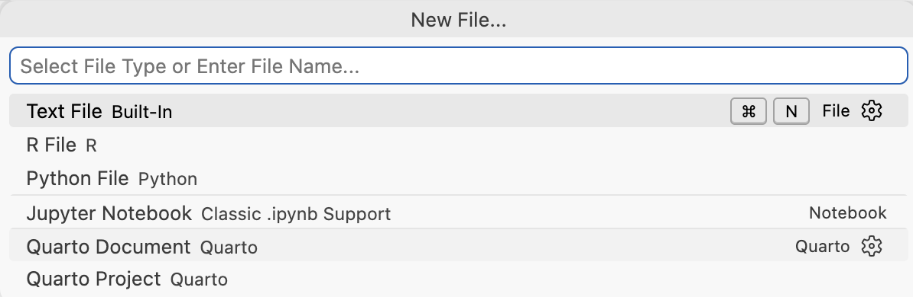
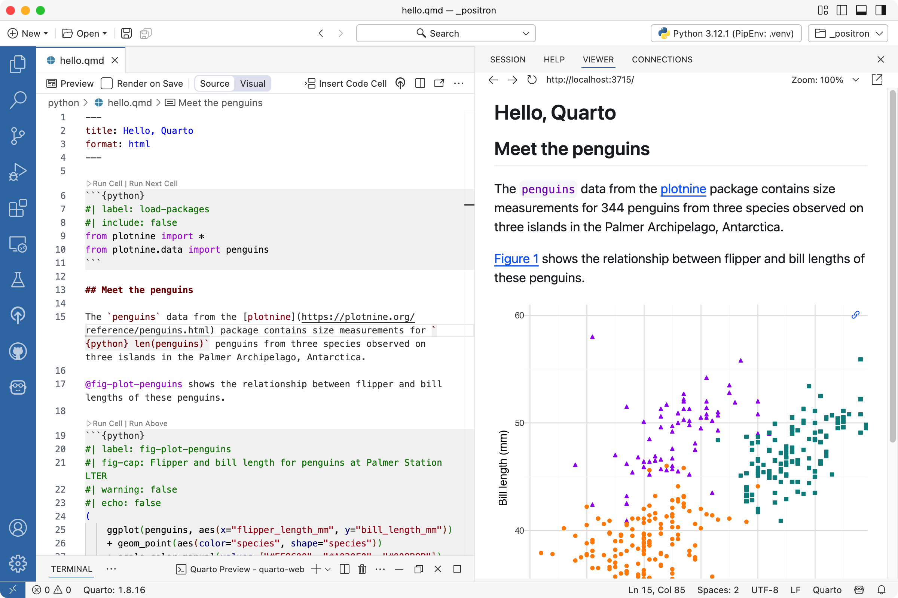
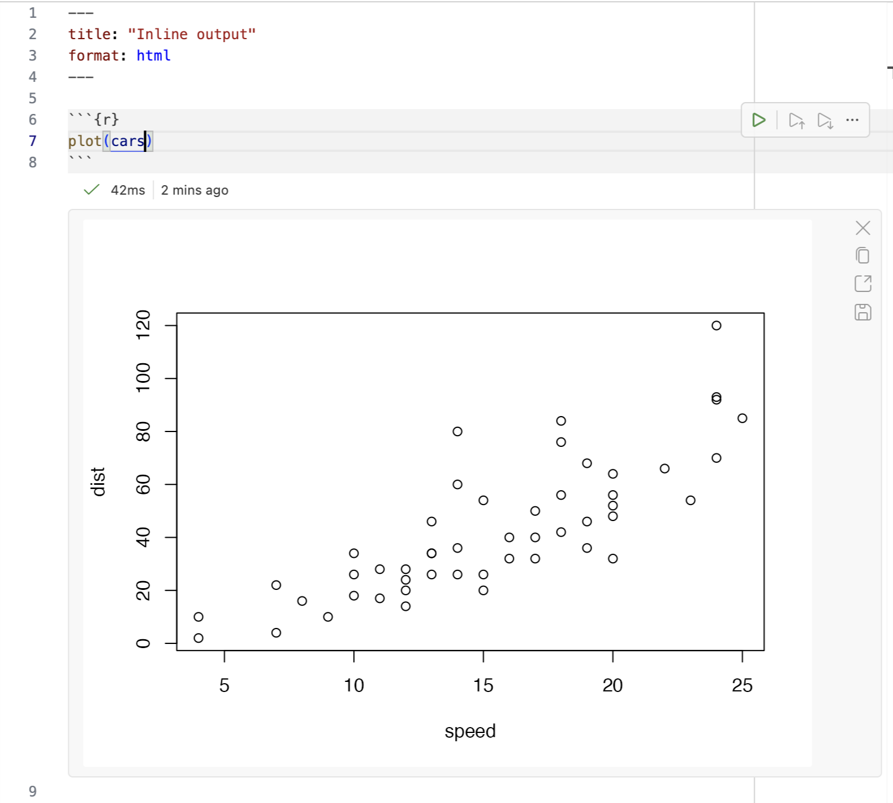
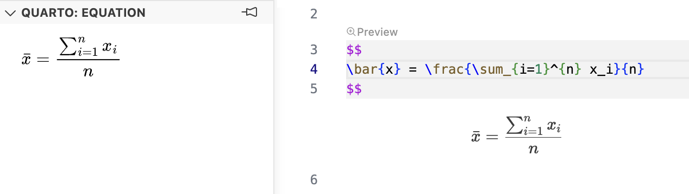
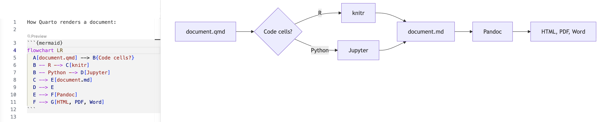
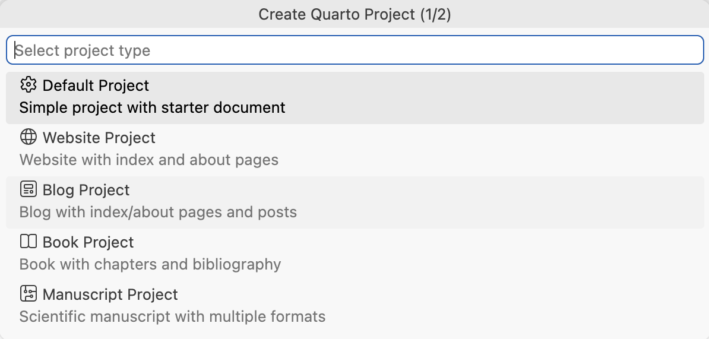

# Your Quarto workflow {#sec-tools}

In this chapter, you’ll learn how to render and preview Quarto documents from the command line, how to author them interactively in various integrated development environments (IDEs) such as Positron and RStudio, which other tools you can use for Quarto authoring, and how to choose the right tool for your workflow.
We spend more time on Positron than on RStudio because RStudio's Quarto support is mature and well documented elsewhere, whereas Positron is newer and its Quarto features are less widely covered.

::: todo
[MCR] Decide if the last sentence above should be taken out.
:::

In @sec-document-structure, we introduced the three main components of a Quarto document: a YAML header for metadata, Markdown text for content, and code cells for executable code.
In this chapter, we will focus on the first two components, the YAML header and Markdown text, before diving into code cells and execution in @sec-code.

The following example shows the basic structure of a Quarto document with a YAML header and Markdown text.

````{.markdown filename="document.qmd"}

````

If you would like to follow along as you read, you can create a new Quarto document with the same structure, save it as `document.qmd`, and experiment with the features of the Quarto CLI and various IDEs in the remainder of this chapter.

## Quarto CLI {#sec-quarto-cli}

Before diving into specific IDEs, let's start with the fundamentals: the Quarto Command Line Interface (CLI).
The Quarto CLI is the core tool that powers all Quarto rendering.
You can run Quarto CLI commands in any standard Terminal application as well as in the Terminal tab in RStudio or the Terminal panel in Positron.

Quarto uses the term *render* for the process of taking a source document, executing its code cells, and producing a new file that combines the code output with the Markdown.
The most fundamental Quarto command is `quarto render`, which renders your document into the desired output format.
You can render a specific Quarto document in the current directory in the Terminal with:

```bash
quarto render document.qmd
```

By default, Quarto will render your document in the format specified in the YAML header, falling back to HTML if none is specified.
You can override the output format using the `--to` option:

```bash
quarto render document.qmd --to pdf
quarto render document.qmd --to docx
```

While `quarto render` creates the output file and stops, `quarto preview` renders your document, opens it, and automatically re-renders it when you save changes to the source file:

```bash
quarto preview document.qmd
```

This command is particularly useful during active authoring, as it lets you see your changes immediately without having to manually rerun the render command.
The preview server will continue running until you stop it (typically with  in the Terminal).

By default, `quarto render` and `quarto preview` operate on a single document at a time.
If you have multiple Quarto documents you want to render at once, you can organize them as a Quarto project (a collection of related documents in a single directory, such as a website or book).
When you run `quarto render` in a project directory, Quarto will operate on all documents in the project according to the project configuration and `quarto preview` will serve the whole project, refreshing whichever pages you edit.
We will discuss projects in more detail in @sec-projects.

Beyond rendering and previewing, the Quarto CLI offers several other helpful commands.

To see which version of Quarto you have installed, run:

```bash
quarto --version
```

To verify that your installation and its dependencies (such as Jupyter, knitr, and LaTeX) are correctly configured, and to see other information that helps with troubleshooting (see @sec-troubleshooting), run:

```bash
quarto check
```

When your document is ready to share, `quarto publish` can render and push it to a variety of destinations:

```bash
quarto publish document.qmd
```

This command starts an interactive session that guides you through the process of publishing your document to the selected destination, including GitHub Pages, Posit Connect, and Posit Connect Cloud.
See @sec-sharing for more details on publishing Quarto documents.

To get help, you can use the following command:

```bash
quarto --help
```

Or you can use `--help` with any command to see available options and usage information.

```bash
quarto render --help
```

The same basic workflow applies whether you work from the Terminal or from an IDE.
IDEs such as Positron, RStudio, and VS Code add buttons, keyboard shortcuts, and preview panes for these tasks, but they run the same Quarto CLI commands behind the scenes.

Now that we have introduced the basic document structure and foundational CLI commands, let's explore how different IDEs integrate these capabilities into their interfaces to support your authoring experience.

## Positron {#sec-positron}

Positron is a next-generation data science IDE that comes pre-configured for Quarto.
Along with integrated rendering and preview, it gives the code in your cells the same R and Python support you'd get in a script: interactive execution in the Console, code completion, help, and diagnostics.

### Installation {#installation-positron}

To get started with Quarto in Positron, download and install Positron from [positron.posit.co](https://positron.posit.co).
Since Quarto is built into Positron, no additional installation is required.
Depending on your language of choice, you'll also need to have R or Python installed on your system—R from [cran.r-project.org](https://cran.r-project.org) or Python from [python.org](https://www.python.org).

To execute code cells in Quarto documents, install the packages for your language of choice:

- For R, you need the knitr and rmarkdown packages:

    ```r
    install.packages("knitr")
    install.packages("rmarkdown")
    ```

- For Python, you need the jupyter package:

    ```bash
    pip install jupyter
    ```

Positron's Quarto support comes from the Quarto VS Code extension, which Positron includes as a *bootstrapped extension*—it behaves just as if you had installed it yourself, updates automatically as new versions appear in the extension gallery, and can be uninstalled if you ever need to.

Positron ships with its own copy of the Quarto CLI, but you aren't locked into it.
If you've installed Quarto yourself—say, to match the version your project uses elsewhere—Positron uses that installation by default: a Quarto on your system `PATH`, or one installed with pip in your active Python environment, takes priority over the bundled copy.
To prefer the bundled copy instead, turn on the  **Quarto: Use Bundled Quarto In Positron** setting (`quarto.useBundledQuartoInPositron`).
When you need finer control over exactly which Quarto is used, set the  [**Quarto: Path**](https://positron.posit.co/quarto.html#managing-quarto-installations) setting (`quarto.path`) to point at the installation you want; it overrides both of the other options.
You can do this at the user or workspace level.

To see which version is currently active, check Positron's bottom status bar (@fig-positron-status-bar-quarto-version).
After changing your Quarto version, restart Positron so the status bar updates.

{#fig-positron-status-bar-quarto-version fig-alt="The left end of Positron's status bar showing, from left to right, the remote connection icon, the Git branch 'main*', a sync icon, zero errors and zero warnings, a debug icon, and the text 'Quarto: 1.11.9'."}

### Creating documents {#creating-documents-positron}

To create a new Quarto document in Positron, use the **Quarto: New Quarto Document** command from the Command Palette, the **File > New File...** menu (@fig-positron-new-file-quarto-document), or the **New** button in the toolbar.
This will open a new untitled `.qmd` file in the Editor, with a placeholder YAML header.
Save the file with a `.qmd` extension to enable Quarto features such as preview and completion.

{#fig-positron-new-file-quarto-document fig-alt="Positron's New File picker with a search box reading 'Select File Type or Enter File Name...' above a list of file types: Text File, R File, Python File, Jupyter Notebook, Quarto Document, and Quarto Project. The Text File row is selected."}

### Core features {#core-features-positron}

Positron provides several features that make Quarto authoring efficient and productive.
Here's an overview; the subsections that follow cover each in more depth:

- Previewing: render `.qmd` files and view the result side by side with your source, using the **Quarto: Preview** command, , or the **Preview** button in the toolbar (see [Previewing and rendering other formats](#previewing-and-rendering-other-formats-positron) and [Render on Save](#render-on-save-positron)).

- Dual editor modes: switch between source and visual editing (see [Visual editor](#visual-editor-positron)).

- Polyglot language support: first-class support for R and Python makes Positron an excellent choice for Quarto projects with computational cells in either language or both languages (see [Contextual assistance](#contextual-assistance-positron)).

- Interactive code execution: insert code cells and run them individually in the Console without rendering the entire document (see [Inserting code cells](#inserting-code-cells-positron), [Running code cells](#running-code-cells-positron), and [Inline output](#inline-output-positron)).

- Code completion and diagnostics: as you type, Positron suggests valid Quarto and YAML options and flags syntax errors, helping you catch problems before you render (see [YAML intelligence](#yaml-intelligence-positron)).

  ::: todo
  [MCR] A screenshot of Quarto help that appears as you type?
  :::

### Basic workflow {#basic-workflow-positron}

The typical workflow for authoring Quarto documents in Positron follows these steps:

1. Create or open a `.qmd` file in the Editor.
2. Preview your document by executing the **Quarto: Preview** command to render and display the output side by side with your source (@fig-positron-preview).
3. Iterate on your content by making edits and re-running the preview. You can optionally enable the **Render on Save** checkbox to automatically update the preview whenever you save your file.
4. Execute code interactively by running individual code cells using the **Run Cell** button, which allows you to test your code without rendering the entire document.

{#fig-positron-preview fig-alt="Positron with a Quarto document titled 'Penguins, meet Quarto!' open on the left side and the rendered version of the document on the right side."}

### Visual editor {#visual-editor-positron}

Positron's visual editor is a WYSIWYM ("what you see is what you mean") interface for editing Quarto Markdown without working directly in the source.
Use the **Edit in Visual Mode** and **Edit in Source Mode** commands or  to switch between modes.
Beyond basic formatting, it supports many of Quarto's richer constructs, including tables, citations, cross-references, footnotes, divs and spans, definition lists, attributes, and raw HTML or LaTeX.
Though the visual editor's support is still somewhat limited in Positron, it's a great fit for rich-text authoring.
We keep the coverage brief here and highlight visual-editor features throughout the book where they're relevant.

::: todo
[MCR] Screenshot of the Positron visual editor if we decide to keep this.
:::

### Editing notebooks {#editing-notebooks-positron}

In addition to the source and visual editors for `.qmd` files, Positron includes a Notebook Editor for authoring Jupyter notebooks (`.ipynb`).
You can render Jupyter notebooks with Quarto just like you can `.qmd` files.
This is a natural fit if you already work in notebooks or prefer a cell-based interface.

Editing an `.ipynb` for Quarto differs from a `.qmd` file in a few ways:

- YAML front matter goes in the first cell, which should be a Raw cell containing the title, author, and any other document options. Use the cell type menu at the bottom right of a cell to switch it to Raw.

- Markdown cells accept any valid Quarto Markdown, including features such as cross-references.

- Code cell options use the same `#|` comment prefix as `.qmd` files and must appear at the very start of the cell.

Run the **Quarto: Preview** command once to start a preview; unlike `.qmd` files, notebooks refresh the preview each time you save, without **Render on Save** enabled.
Another key difference is execution: `.qmd` files are executed by default when rendered, but when rendering an `.ipynb`, Quarto does *not* run the cells by default, assuming you've already executed them while editing.
To execute cells during rendering, pass the `--execute` flag:

```bash
quarto render notebook.ipynb --execute
```

or enable it in the notebook's YAML front matter:

```yaml
execute:
  enabled: true
```

You can convert between `.qmd` and `.ipynb` representations at any time with `quarto convert`:

```bash
quarto convert notebook.ipynb
quarto convert notebook.qmd
```

::: todo
[MCR] Screenshot of the Notebook Editor with a Raw front-matter cell?
:::

### Inserting code cells {#inserting-code-cells-positron}

To insert a new code cell in a `.qmd` file, click the **Insert Code Cell** button in the Editor toolbar, or run the **Quarto: Insert Code Cell** command from the Command Palette.
You can also use the keyboard shortcut .

Positron chooses the language for the new cell as follows:

1. If the cursor is inside a code cell, the command splits that cell in two at the cursor, so both halves keep the same language.
2. Otherwise, it uses the language of the closest code cell above the cursor, or the first cell below the cursor if there is none above.
3. If the document has no code cells yet, it uses the language of your foreground interpreter session, for example R or Python.
4. If none of these apply, it offers a list of languages to choose from.

If you have text selected, it is placed inside the new cell.

### Running code cells {#running-code-cells-positron}

Positron provides a full set of commands for running R and Python cells, with output appearing in the Console.
You can run the current cell, the next or previous cell, all cells, the cells above or below the cursor, or just the selected line(s):

| Command | Shortcut |
|---|---|
| **Run Current Cell** |  |
| **Run Selected Line(s)** |  |
| **Run Next Cell** |  |
| **Run Previous Cell** |  |
| **Run All Cells** |  |
| **Run Cells Above** |  |
| **Run Cells Below** |  |

Completion and execution for R and Python cells are built into Positron.
To add completion and execution for Julia, install the Julia extension.

### Inline output {#inline-output-positron}

By default, running a code cell sends it to the Console, as described above.
Positron can instead display cell output *inline*, directly beneath each cell in the Editor—much like a Jupyter notebook (@fig-positron-inline-output).
To use this feature, you must first turn on the  [**Quarto > Inline Output: Enabled**](https://positron.posit.co/quarto-inline-output.html) setting (`quarto.inlineOutput.enabled`) in your user or workspace settings.

Turning on inline output also changes the execution model.
Rather than sharing a single Console across every document, Positron gives each `.qmd` file its own isolated R or Python session, so objects you create in the Console or in another document aren't available to it.

{#fig-positron-inline-output fig-alt="Positron's Editor showing a Quarto document with a YAML header (title 'Inline output', format html) and an R code cell containing plot(cars). Below the cell, a status line reads '42ms' with a green check mark, and below that a scatterplot of dist against speed appears inside the Editor, with buttons to close, copy, open, and save the plot."}

### Contextual assistance {#contextual-assistance-positron}

While you edit R and Python code cells, Positron offers the same assistance you'd get in a script or the Console: completion for functions and their arguments, help tooltips as you type or hover over a function, and full documentation in the Help pane when you press F1 with the cursor in a function.

For assistance with the prose and math around your code, run the **Quarto: Show Assist Panel** command to open a panel in the sidebar that updates based on where your cursor is.
It shows a preview of LaTeX math as you edit an equation (@fig-positron-assist-panel-equation), and a thumbnail preview when your cursor is on a Markdown image—handy for confirming you've referenced the right file.

{#fig-positron-assist-panel-equation fig-alt="On the left, Positron's sidebar shows a panel titled 'QUARTO: EQUATION' containing the rendered formula x-bar equals the sum of x sub i from i equals 1 to n, divided by n. On the right, the Editor shows the LaTeX source of the same equation between double dollar signs, with a 'Preview' link above it and the rendered equation displayed beneath it."}

### Live preview {#live-preview-positron}

When you're writing LaTeX math or a Mermaid or Graphviz diagram, you can open a live preview that re-renders automatically as you type.
Click the **Preview** button above the code, or use the  shortcut.
The preview appears alongside your document, so you can catch mistakes in an equation or diagram without rendering the whole file.
You can see the live preview of an equation, beneath its source, in @fig-positron-assist-panel-equation; @fig-positron-live-preview-diagram shows the live preview of a diagram.

{#fig-positron-live-preview-diagram fig-alt="On the left, Positron's Editor shows a Quarto document with the line 'How Quarto renders a document:' and a mermaid code cell defining a left-to-right flowchart. On the right, the rendered flowchart shows document.qmd leading to a 'Code cells?' decision, which branches to knitr for R and Jupyter for Python; both lead to document.md, then to Pandoc, then to 'HTML, PDF, Word'."}

### Previewing and rendering other formats {#previewing-and-rendering-other-formats-positron}

The **Quarto: Preview** command renders and previews your document's *default* format.
To preview a different format, use the **Quarto: Preview Format** command (@fig-positron-preview-format), which offers a list of formats to choose from—those declared in the document plus standard options like PDF and MS Word.
After you preview a different format, the **Quarto: Preview** command and its keyboard shortcut rebind to that format for the duration of the preview; run the **Quarto: Preview Format** command again to switch back.

{#fig-positron-preview-format fig-alt="Positron's quick pick for the Quarto: Preview Format command, with an empty search box above four options. Preview HTML (format: html) is listed under Declared Formats and is highlighted. Preview PDF (Typst) (format: typst), Preview PDF (LaTeX) (format: pdf), and Preview MS Word (format: docx) are listed under Other Formats."}

Embedded, side-by-side preview is available for HTML- and PDF-based formats, including `revealjs` and `beamer` slides.
For Word and other formats, Positron renders the file, but you'll open it in an external application to view the result.

Because preview renders only one format at a time, use the **Quarto: Render Document** command when a document declares multiple formats and you want to produce all of them.
This command lets you render all declared formats at once, or selectively render any declared or standard format, such as PDF or MS Word.

### Render on Save {#render-on-save-positron}

By default, Positron does not re-render your document every time you save—rendering can be slow if it involves long-running computations, and it's useful to be able to save freely without triggering a full render.
This differs from running `quarto preview` yourself in the Terminal (see @sec-quarto-cli): the **Quarto: Preview** command starts the preview with `--no-watch-inputs`, which turns off the automatic re-render on save, so Positron can decide when to re-render based on your **Render on Save** setting.
When you do want automatic rendering, you have three ways to enable **Render on Save**:

1. Check the **Render on Save** checkbox in the Editor toolbar for the current document.
2. Search for `quarto.render` in settings and enable the  [**Quarto > Render: Render on Save**](https://quarto.org/docs/tools/positron/index.html#render-on-save) setting (`quarto.render.renderOnSave`) to make it the default for all documents.
3. Set the `editor` option in your front matter (or project `_quarto.yml`), which overrides the Positron setting:

    ```yaml
    editor:
      render-on-save: true
    ```

With **Render on Save** enabled, the preview refreshes automatically each time you save.

::: callout-note
Jupyter notebooks (`.ipynb`) are the exception to this default.
Once you start a preview of a notebook with the **Quarto: Preview** command, the preview refreshes each time you save the notebook, without you having to enable **Render on Save** (see [Editing notebooks](#editing-notebooks-positron)).
:::

### External preview {#external-preview-positron}

By default, the rendered preview opens in a side-by-side panel inside Positron.
If you'd rather preview in an external browser—or suppress the automatic preview entirely—change the  [**Quarto > Render: Preview Type**](https://quarto.org/docs/tools/positron/index.html#external-preview) setting (`quarto.render.previewType`).
Search for `quarto preview type` in user or workspace settings to find the setting, which offers three choices: `internal` (the default side-by-side panel), `external` (open in your default browser), and `none` (render without opening a preview).

### Projects {#projects-positron}

To create a project for a Quarto document or a set of related documents, run the **Quarto: Create Project** command from the Command Palette, or choose **Quarto Project** from the **File > New File...** menu.
Positron asks you to pick a project type (**Default**, **Website**, **Blog**, **Book**, or **Manuscript**), as shown in @fig-positron-create-project, then creates the project and opens its folder.

{#fig-positron-create-project fig-alt="Positron's quick pick titled 'Create Quarto Project (1/2)' with a search box reading 'Select project type' above five options, each with a short description: Default Project (Simple project with starter document), Website Project (Website with index and about pages), Blog Project (Blog with index/about pages and posts), Book Project (Book with chapters and bibliography), and Manuscript Project (Scientific manuscript with multiple formats). Default Project is highlighted."}

### YAML intelligence {#yaml-intelligence-positron}

Positron provides code completion for the YAML you write in Quarto documents, covering project files, the document's YAML front matter, and executable cell options.
As you type, it suggests valid keys and values, which helps you discover options and avoid typos.
If your YAML is invalid, Positron also flags it when you save the document, so you can fix it before rendering.

### Additional Positron features {#additional-features-positron}

Positron provides several additional features and tools that enhance your Quarto workflow:

- Get help from Posit Assistant, the AI assistant built into recent versions of Positron, which connects to your live R or Python session to help you author, explore, and debug. Its Quarto-specific skills include authoring `.qmd` documents—covering cross-references, callouts, citations, diagrams, and YAML options—generating reports from a conversation, and publishing your work to Posit Connect Cloud.

- Navigate long documents easily using the document outline panel in the primary sidebar.

- Insert common code patterns quickly with built-in code snippets using the **Snippets: Insert Snippet** command.

- Version control your Quarto documents directly from the IDE with its Git integration.

- Open a Terminal already set to the correct working directory, for running Quarto CLI commands.

## RStudio {#sec-rstudio}

RStudio is an IDE designed specifically for R, and it has long supported Quarto authoring.
It comes with Quarto pre-installed, so you can create, edit, and render Quarto documents without any additional setup.

### Installation {#installation-rstudio}

To get started with Quarto in RStudio, download and install the latest version of RStudio from [posit.co/download/rstudio-desktop](https://posit.co/download/rstudio-desktop/).
Also make sure that you have R installed on your system, which you can get from [cran.r-project.org](https://cran.r-project.org).

### Creating documents {#creating-documents-rstudio}

To create a new Quarto document in RStudio, use the **File > New File > Quarto Document…** menu.
This opens the New Quarto Document dialog, where you can give the document a title and author and choose a default output format before RStudio creates a ready-to-edit `.qmd` file.

::: todo
[MCR] Screenshot of the New Quarto Document dialog?
:::

### Core features {#core-features-rstudio}

Like Positron, RStudio provides several features that make Quarto authoring efficient and productive.
Here's an overview; the subsections that follow cover each in more depth:

- Rendering and preview: render `.qmd` files to HTML, PDF, Word, or other formats with the **Render** button or  (see [Previewing and rendering other formats](#previewing-and-rendering-other-formats-rstudio) and [Render on Save](#render-on-save-rstudio)).

- Dual editor modes: switch between source and visual editing (see [Visual editor](#visual-editor-rstudio)).

- Interactive code execution: run individual code cells without rendering the entire document (see [Running code cells](#running-code-cells-rstudio) and [Inline output](#inline-output-rstudio)).

- Code completion and diagnostics: as you type, RStudio suggests valid Quarto and YAML options and flags errors before you render (see [YAML intelligence](#yaml-intelligence-rstudio)).

### Basic workflow {#basic-workflow-rstudio}

The authoring loop in RStudio mirrors the one described for Positron above: create or open a `.qmd` file, click the **Render** button (or press ) to preview the output, then iterate as you edit.
You can enable **Render on Save** so the preview refreshes automatically, and run individual code cells as you go rather than rendering the whole document each time.

::: callout-note
RStudio's **Render** button actually calls `quarto preview`.
:::

### Visual editor {#visual-editor-rstudio}

RStudio pioneered the visual editor that Positron later inherited, so the experience described in the [Visual editor](#visual-editor-positron) section for Positron largely carries over: a WYSIWYM interface covering tables, citations, cross-references, footnotes, divs and spans, definition lists, attributes, and raw HTML or LaTeX.
Switch between source and visual modes with the buttons in the Editor toolbar or .

::: todo
[MCR] Screenshot of the RStudio visual editor.
:::

### Inserting code cells {#inserting-code-cells-rstudio}

To insert a new code cell in a `.qmd` file, click the **Insert a new code chunk** button in the Editor toolbar, choose **Code > Insert Chunk** from the menu, or use the keyboard shortcut .
The button has a dropdown that lets you pick the language of the new cell, such as R or Python, while the menu and shortcut insert a cell in the document's default language.

::: todo
[MCR] Confirm the button's label, the menu path, and the shortcut, and how RStudio picks the language for the menu and shortcut (e.g., does it follow the previous cell?). Screenshot of the button's language dropdown?
:::

### Running code cells {#running-code-cells-rstudio}

As in Positron, you can execute code cells interactively rather than rendering the whole document.
Each cell has a **Run** button in its top-right corner, and  runs the current cell, with additional commands to run the next cell or all cells above or below.

::: todo
[MCR] Confirm RStudio's default cell-execution shortcuts against the current keyboard shortcut reference.
:::

### Inline output {#inline-output-rstudio}

Cell output can appear directly beneath each cell in the Editor instead of in the Console (see the [Inline output](#inline-output-positron) section for the equivalent Positron feature).
Toggle between inline and console output from the gear (settings) menu in the Editor toolbar, or set a default for all documents in RStudio's global options.

::: todo
[MCR] Confirm the exact menu path and labels for the inline-vs-console output toggle in RStudio.
:::

### Contextual assistance {#contextual-assistance-rstudio}

While you edit cells, RStudio offers the same kinds of assistance as Positron: completion for functions and their arguments, and function documentation in the Help pane when you press F1.

### Previewing and rendering other formats {#previewing-and-rendering-other-formats-rstudio}

RStudio's **Render** button renders the format declared in your document's YAML header.
To produce a different format, change the `format` in the YAML header—or pick one from the dropdown next to the **Render** button—and render again.

::: todo
[MCR] Confirm the **Render** button's format dropdown behavior in the current RStudio release.
:::

### Render on Save {#render-on-save-rstudio}

Like Positron, RStudio can re-render your document automatically each time you save.
Enable the **Render on Save** checkbox in the Editor toolbar; RStudio then refreshes the preview whenever you save the file.
RStudio doesn't support the `editor: render-on-save` front matter option (see [Render on Save](#render-on-save-positron)), so use the checkbox instead.

### External preview {#external-preview-rstudio}

By default, RStudio shows the rendered preview in the Viewer pane, beside the Editor.
You can change where previews appear—for example, opening them in a separate window—in RStudio's global options.

::: todo
[MCR] Confirm the preview-location options and their labels (Viewer pane, Window, etc.) in RStudio's global options.
:::

### Projects {#projects-rstudio}

To create a project for a Quarto document or a set of related documents, use the **File > New Project…** menu, choose **New Directory**, and then select a project type: **Quarto Project**, **Quarto Website**, **Quarto Blog**, **Quarto Book**, or **Quarto Manuscript**.

The New Project wizard also provides options to initialize a [git](https://git-scm.com/) repository and set up an [renv](https://rstudio.github.io/renv/) environment, which help make your project reproducible from the start.

::: todo
[MCR] Screenshot of the Create Quarto Project wizard?
:::

### YAML intelligence {#yaml-intelligence-rstudio}

RStudio provides code completion for the YAML you write in Quarto documents, covering project files, the document's YAML front matter, and executable cell options.
As you type, it suggests valid keys and values, which helps you discover options and avoid typos.
If your YAML is invalid, RStudio also flags it when you save the document, underlining the problem so you can fix it before rendering.

::: todo
[MCR] Screenshots of YAML completion and diagnostics?
:::

### Additional RStudio features {#additional-features-rstudio}

Like Positron, RStudio has a built-in Terminal and Git integration through the Git pane.

The document outline looks a bit different in RStudio, where it is located in the Editor pane.

::: todo
[MCR] Screenshot of outline panel in RStudio?
:::

::: todo
[MCR] Anything about code snippets in RStudio? I don't use them so I'm not sure.
:::

## Other tools {#sec-other-tools}

While Positron and RStudio offer rich, integrated experiences for Quarto authoring, you can use Quarto with many other tools depending on your preferences and workflow.

### VS Code

Visual Studio Code with the Quarto extension provides excellent support for authoring Quarto documents.
This is the same extension that Positron bundles, so most of the Quarto features described in @sec-positron—preview, the visual editor, completion for YAML options, the Assist Panel, and running code cells—work the same way in VS Code.
The main difference is language support: Positron has R and Python support built in, while in VS Code you need to install the language extensions yourself to get completion and code execution in cells (the Python and Jupyter extensions for Python, the R extension for R, or the Julia extension for Julia).
VS Code is particularly popular among Python developers and those who work across multiple programming languages.

To get started with VS Code, first install VS Code from [code.visualstudio.com](https://code.visualstudio.com).
Then install the Quarto CLI from [quarto.org](https://quarto.org/docs/get-started/) and the Quarto extension from the VS Code Marketplace.

Similar to Positron and RStudio, you can preview documents with the keyboard shortcut  and run individual code cells with .

### JupyterLab

If you're already working with Jupyter notebooks (`.ipynb` files), you can use Quarto to render them to various output formats.
JupyterLab provides an interactive environment for working with notebooks, and the Quarto CLI can render these notebooks just as it renders `.qmd` files.

You can also install the Quarto JupyterLab extension, which displays Quarto-specific Markdown—such as callouts, divs, and Mermaid diagrams—correctly in your notebook's Markdown cells, and shows the document's front matter as a title block.
Rendering happens through the Quarto CLI, for example by running `quarto preview notebook.ipynb` in JupyterLab's Terminal.
The preview updates automatically each time you save the notebook, so you can keep a browser window with the preview open alongside JupyterLab.

To learn more about using Quarto with JupyterLab, refer to the Quarto documentation at <https://quarto.org/docs/tools/jupyter-lab.html>.

### Neovim and Vim

For developers who prefer terminal-based editors, both Neovim and Vim can be configured to work with Quarto documents.
For Neovim, plugins provide features like syntax highlighting, code execution, and preview integration; to learn more, refer to the Quarto documentation at <https://quarto.org/docs/tools/neovim.html>.
For Vim, the [quarto-vim](https://github.com/quarto-dev/quarto-vim) plugin provides syntax highlighting for `.qmd` files.

### Other editors

Since Quarto documents are plain text files, you can author them in virtually any text editor:

- Emacs: With Markdown mode and language-specific modes (ESS for R, python-mode, etc.).
- Sublime Text: Using Markdown packages and build systems.
- Zed: With Markdown support and terminal integration.
- Any plain text editor: You can always author in your favorite editor and use `quarto render` from the command line.

## Choosing a tool {#sec-choosing-tool}

The best tool for Quarto authoring depends on your specific needs and existing workflow:

- If you primarily work with R, RStudio provides the most integrated experience, with robust support for R-specific features.

- If you work in both R and Python, or with Jupyter notebooks, Positron offers a rich set of features, with strong support for both languages.

- If you already use VS Code for development, adding the Quarto extension gives you powerful Quarto capabilities in your familiar environment.

- If your workflow is notebook-first, JupyterLab lets you keep authoring in `.ipynb` files and render them with Quarto, with the Quarto extension displaying Quarto Markdown in your cells.

- If you prefer keyboard-driven, terminal-based workflows, editors like Neovim or Vim can be configured to work effectively with Quarto.

Whichever editor you choose, the core Quarto workflow is the same: write plain-text source, preview as you develop, render to produce the final output, and use projects to make the work reproducible.

::: todo
[MCR] Try all shortcuts with default settings before finalizing.
:::
