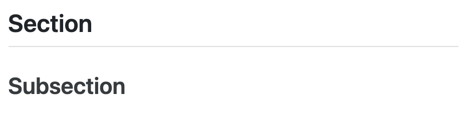
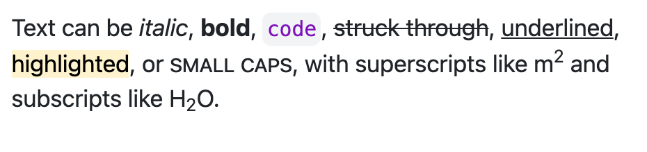
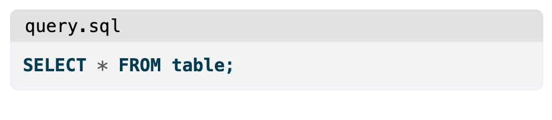
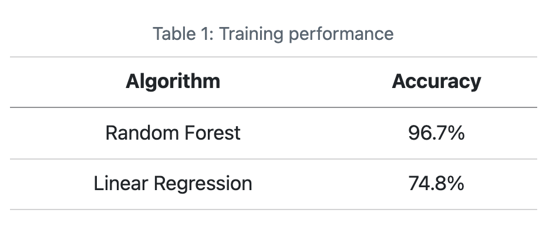
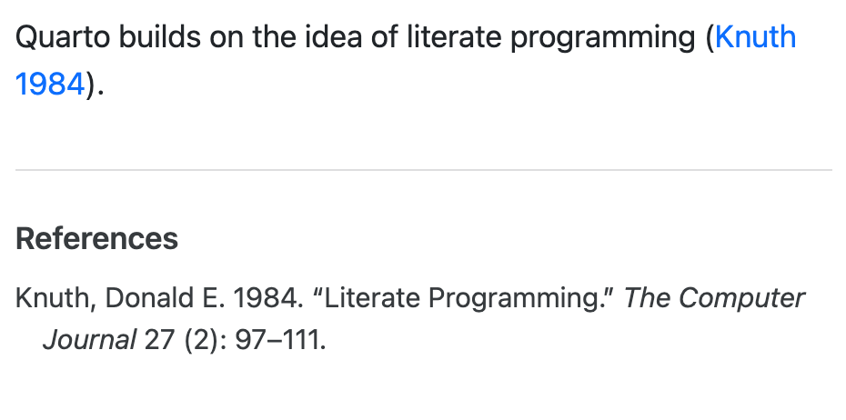
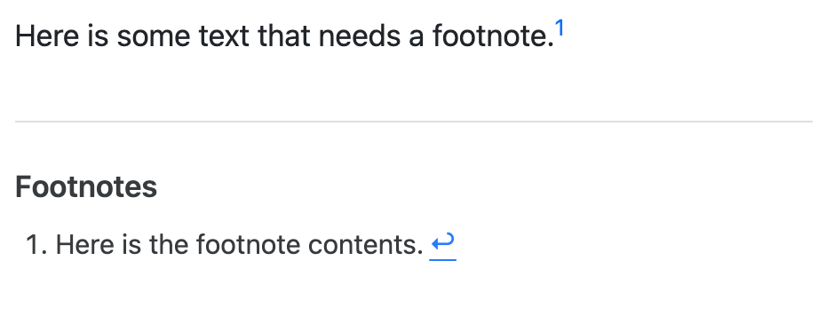
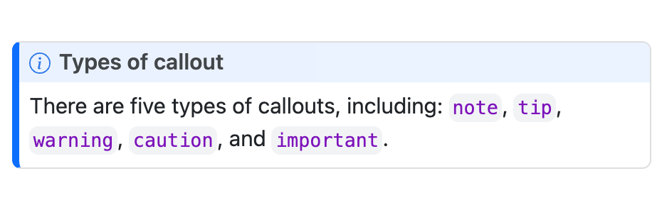
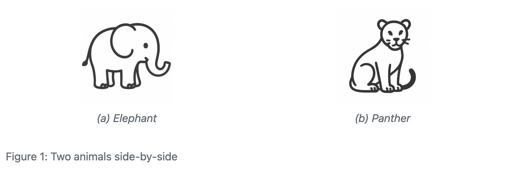

# Writing content {#sec-writing}

Beyond the document header and executable code cells, the content of a Quarto document is written in markdown.
But not just any flavor of markdown, Quarto's own flavor called **Quarto markdown**.
In this chapter, you'll learn just enough about Quarto markdown to get you writing simple documents right away. 
We'll tease you with some of the rich content you can create with Quarto markdown, but delay a comprehensive coverage of things like equations, cross-references, citations, callouts, figures and tables to @sec-authoring.

## Basics

Markdown is a plaintext syntax for describing document structure.
Here's some example markdown in a Quarto document:

````{.markdown filename="document.qmd"}

````

Markdown is a popular format, so the syntax above may be familiar.
You've likely used it if you've opened an issue on Github, or formatted some text in a Discord post.
However, as markdown's popularity has grown, so has the number of variants, or flavors, of the syntax.

The example above illustrates components of markdown syntax that are common across many markdown variants:

* Headings: text prefaced by one or more hashes (`#`), surrounded by blank lines.

* Paragraphs: text separated by blank lines.

* Bold: text surrounded by `**`

* Italic: text surrounded by `_`

* Code: text surrounded by `` ` ``

* Links: text inside square brackets (`[]`) followed by a URL in parentheses (`()`)

When rendered the structure described by markdown is translated to the relevant components in the target format, e.g. HTML tags for `format: html`, or Typst functions for `format: typst`.

@fig-writing-basics-document shows `document.qmd` rendered with `format: html` and with `format: typst`.

::: {#fig-writing-basics-document}
::: {layout-ncol=2}
{#fig-writing-basics-document-html .border fig-alt="A rendered HTML page with the heading My First Section, followed by two paragraphs. The paragraphs show bold text, italic text, the word code in a monospace font on a gray background, and an underlined blue link that reads link to Quarto."}

{#fig-writing-basics-document-typst .border fig-alt="A rendered PDF page with the heading My First Section in a serif font, followed by two paragraphs. The paragraphs show bold text, italic text, and the word code in a monospace font. The link text, link to Quarto, looks the same as the text around it."}
:::

`document.qmd` rendered to two formats.
:::

## Features of Quarto markdown

Describing basic document structure, like headings and paragraphs, and simple text formatting is enough to get started with Quarto. 
But you may soon be looking for richer content like tables, figures, code blocks, citations, and cross-references.
Adding these components is a matter of adding the appropriate Quarto markdown.
As a teaser, here's an example contains a callout and a cross-reference:

````{.markdown .code-overflow-wrap filename="document.qmd"}

````

It is important to remember that Quarto markdown is a specific flavor of markdown---although it shares much of its syntax with other variants you shouldn't expect a component of any arbitrary markdown variant to work with Quarto.

The above example illustrates two pieces of syntax you'll see often in Quarto markdown that you might not have seen in other variants:

* Attributes: additional metadata for a component specified inside curly braces, e.g the `{#fig-repsonse}` on the image. You'll see lots of examples in @sec-authoring, and can specifically learn more in @tip-attributes.

* Fenced divs: blocks of content inside colon delimited sections, often with attributes attached, e.g. the callout:
  
  ```markdown
  ::: {.callout-caution}
  Content
  :::
  ``` 

  Fenced divs are used in Quarto to implement lots of different block level treatments: callouts, figure or table panels, and complex layouts.

@sec-authoring covers the most useful features of Quarto markdown in more detail.
For a quick tour, @tbl-writing-quick-reference shows an example of each feature, along with a pointer to the section of @sec-authoring where you can learn more.

::: {#tbl-writing-quick-reference}

::: {.list-table header-rows=1 widths='1,2' aligns="l,l"}

* - Element
  - Output

* - **Headings**, @sec-markdown-sections
  - {.border width="100%" fig-alt="A rendered HTML page with a large bold heading, Section, underlined by a thin gray rule, followed by a smaller bold heading, Subsection."}

* - **Text formatting**, @sec-markdown-text
  - {.border width="100%" fig-alt="A rendered sentence showing the words italic, bold, code in a monospace font on a gray background, struck through with a line through it, underlined, highlighted with a yellow background, and small caps, followed by m with a superscript 2 and H2O with a subscript 2."}

* - **Links**, @sec-markdown-text
  - {.border width="100%" fig-alt="The sentence Link to Quarto, or show the URL itself: https://quarto.org, where Quarto and https://quarto.org are blue underlined links."}

* - **Lists**, @sec-markdown-lists
  - {.border width="100%" fig-alt="A rendered compact bulleted list with three items: First item, Second item, and Third item."}

* - **Code blocks**, @sec-code-blocks
  - {.border width="100%" fig-alt="A rendered code block with a gray header reading query.sql above the syntax highlighted code SELECT * FROM table;."}

* - **Tables**, @sec-markdown-tables
  - {.border width="100%" fig-alt="A rendered table captioned Table 1: Training performance, with columns Algorithm and Accuracy and two rows: Random Forest, 96.7%, and Linear Regression, 74.8%."}

* - **Figures**, @sec-markdown-figures
  - {.border width="100%" fig-alt="A rendered line drawing of an elephant, centered, with the caption Figure 1: Elephant below it."}

* - **Math**, @sec-equations
  - {.border width="100%" fig-alt="The text The formula is:, followed by the equation E equals m c squared, typeset and centered on its own line."}

* - **Cross-references**, @sec-crossreferences
  - {.border width="100%" fig-alt="The sentence See Figure 1 and Table 1, where Figure 1 and Table 1 are blue underlined links."}

* - **Citations**, @sec-citations
  - {.border width="100%" fig-alt="The sentence Quarto builds on the idea of literate programming (Knuth 1984), where Knuth 1984 is a blue link. Below a horizontal rule, a References heading lists: Knuth, Donald E. 1984. Literate Programming. The Computer Journal 27 (2): 97–111."}

* - **Footnotes**, @sec-footnotes
  - {.border width="100%" fig-alt="The sentence Here is some text that needs a footnote, followed by a blue superscript 1. Below a horizontal rule, a Footnotes heading lists: 1. Here is the footnote contents, followed by a return arrow link."}

* - **Callouts**, @sec-callouts
  - {.border width="100%" fig-alt="A rendered note callout with a blue left border and an information icon. The light blue header reads Types of callout, and the body reads: There are five types of callouts, including: note, tip, warning, caution, and important, with each type in a monospace font."}

* - **Layout**, @sec-layout
  - {.border width="100%" fig-alt="Two line drawings side by side: an elephant on the left captioned (a) Elephant, and a panther on the right captioned (b) Panther. Below both, the shared caption Figure 1: Two animals side-by-side."}

:::

Quick reference for common Quarto markdown syntax
:::

## Things to watch out for

### White space matters (sometimes)

You can often ignore whitespace when you are writing Quarto markdown.
For example, extra spaces inline with text are ignored, as are newlines within a paragraph.
That is, the following markdown snippets are equivalent:

``` {.markdown}
A sentence  with   weird     spacing.   And    another.
This is on a new line.
```

```{.markdown}
A sentence with weird spacing. And another. This is on a new line.
```

However, there are some places white space is important:

* **Blank lines**: you must have a blank line before the items in a list, and before a code block or cell. Without the blank line, Quarto won't identify the component correctly, so you'll get list items that all appear on a single line, or a code block syntax (the `` ``` ``) showing up in the rendered document.

* **Indentation**: items in a list need consistent indentation. Problems with indentation most often occur when an item has multiple paragraphs, or contains something like a code block. You'll notice that your items don't seem properly aligned in the output (usually not enough indentation), or something suddenly looks like a code block (usually too much indentation).

If your content isn't rendering as expected, double-check your use of whitespace.

### The difference between code blocks and code cells

There is a distinction between **code cells** and **code blocks**:

* **Code cells**, sometimes also called **code chunks**, are code that will be executed and replaced with computational output. Code cells use the syntax:

    ````markdown
    ```{r}
    # Code to be executed
    ```
    ````

    Code cells are the subject of the next chapter, @sec-code

* **Code blocks** are code that should be syntax highlighted but simply displayed, not executed. Code blocks use the syntax:

    ````markdown
    ```{.r}
    # Code to be displayed
    ```
    ````

    Or the syntax:

    ````markdown
    ``` r
    # Code to be displayed
    ```
    ````

    You'll can more about code blocks in @sec-code-blocks.

The syntax difference, as little as a `.`, means it is easy to mistake one for the other in your document.
However, the differences in behavior are huge---code cells are handled by the computational engine, code blocks are not. 
When you are reading examples, or trouble-shooting your own documents, keep that distinction in mind and be wary of trying to apply solutions for code blocks to code cells and vice versa.

## Wrap Up

